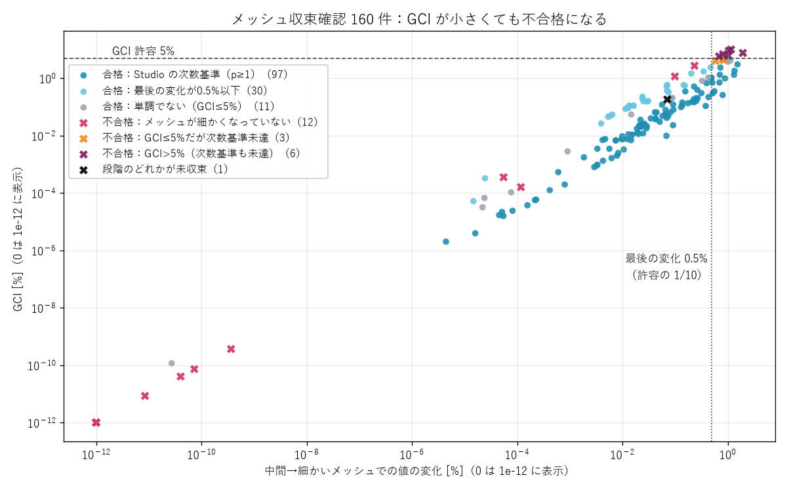
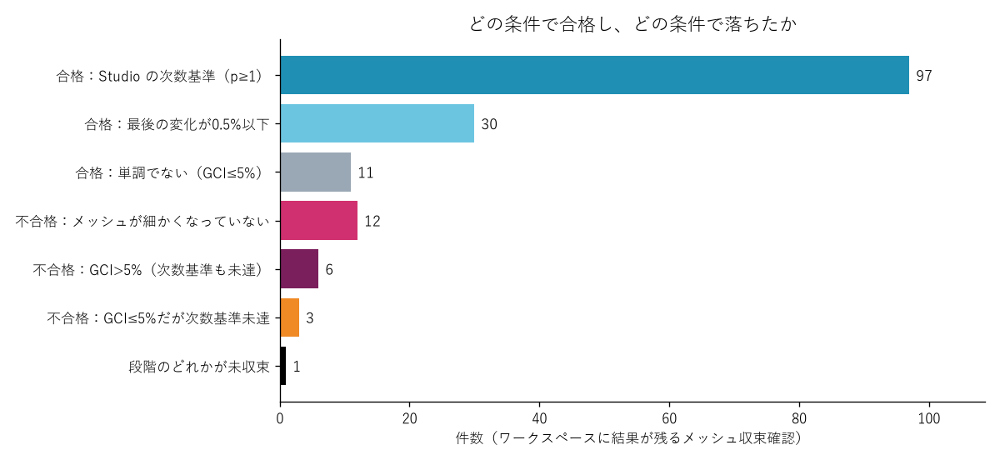

有限要素法の答えは、メッシュの細かさで変わります。AI エージェントに解析を任せるなら、「この数字はメッシュを細かくしても変わらないか」を、AI の自己申告ではなく機械的に判定したくなります。

NovaSolver Studio（無料・オープンソースの解析ソフト）には、3 段階のメッシュで解いて Roache の GCI（Grid Convergence Index）を計算し、合否を返す MCP ツール `check_convergence` があります。Claude Code が書いた Python のスクリプトから、このツールを構造・熱・流れ・静電場・電流の解析で呼びました。

ワークスペースに結果ファイルが残っている収束確認は **160 件**。そのうち **22 件**が不合格でした。この記事では、ゲートの実装と、落ちた 22 件の内訳を並べます。


*横軸は中間→細かいメッシュでの値の変化、縦軸は GCI。✕ が不合格*

左下に、GCI が 10⁻¹⁰% 前後なのに不合格の点が並んでいます。数字だけ見れば「完璧に収束」ですが、ゲートはこれを落としました。理由は後で説明します。

## ゲートの実装

### 3 段階のメッシュで同じ量を解く

`check_convergence` は、メッシュの寸法を「粗い・標準・細かい」の 3 段階にして、同じケースを 3 回解きます。比べる量は物理ごとに 1 つ決まっています（固有振動なら第 1 固有振動数、静電場なら静電容量など）。代表寸法 h は要素数 N から $h = N^{-1/3}$ とします。

```python
for i, size in enumerate(("coarse", "normal", "fine")):
    ...
    name, val, unit = primary_quantity(snap, res)
    n = res["metrics"].get("solver_cells") or res["metrics"].get("elements") or 1
    levels.append({"size": size, "elements": n, "h": n ** (-1 / 3), "value": val, "converged": res["converged"], ...})
```

### GCI の計算

3 つの値 $f_1, f_2, f_3$（粗→細）から、観測次数 p と GCI を求めます。

```python
def gci(levels: list[dict], fs: float = 1.25) -> dict:
    """Roache's Grid Convergence Index from three meshes (coarse -> fine), h ~ N^(-1/3)."""
    (h1, f1), (h2, f2), (h3, f3) = [(l["h"], l["value"]) for l in levels]
    r21, r32 = h1 / h2, h2 / h3
    e21, e32 = f2 - f1, f3 - f2
    monotone = e21 * e32 > 0 and abs(e32) > 0
    asymptotic = False
    if monotone:
        r = math.sqrt(r21 * r32)
        p = math.log(abs(e21 / e32)) / math.log(r)
        asymptotic = p >= 1.0
        if not asymptotic:
            p, fs = 1.0, 3.0
        p = min(p, 4.0)
    else:
        p, fs = 2.0, 3.0                         # oscillatory or exact: conservative safety factor
    denom = r32 ** p - 1
    scale = abs(f3) if f3 != 0 else abs(f2)
    rel = abs(e32) / scale if scale > 0 else 0.0
    gci_fine = fs * rel / denom * 100 if denom > 0 else rel * 100
```

要点は 3 つです。

- 単調に変化し、観測次数が $p \ge 1$ なら Studio は `asymptotic` を立て、安全係数 1.25 で GCI を出す
- 単調でも $p < 1$（Studio の次数基準を満たさない）なら、p = 1・安全係数 3 に切り替え、外挿値は出さない
- 単調でない（振動する、または差がゼロ）なら p = 2・安全係数 3

### 合否の条件は GCI だけではない

```python
tol = 5.0
# a study only means something if the mesh really got finer; identical meshes would "agree" perfectly
refined = all(b["elements"] >= 1.3 * a["elements"] for a, b in zip(levels, levels[1:]))
settled = g["asymptotic"] or not g["monotone"] or g["rel_change_pct"] <= tol / 10
passed = all(l["converged"] for l in levels) and g["gci_pct"] <= tol and refined and settled
```

合格には 4 つの条件をすべて満たす必要があります。

| 条件 | 意味 |
|---|---|
| 各段階のソルバーが収束 | 3 回とも反復計算が終わっている |
| GCI ≤ 5% | 離散化誤差の見積もりが許容内 |
| refined | 段階ごとに要素数が 1.3 倍以上に増えている |
| settled | Studio の `asymptotic` が真、単調でない、または最後の変化が許容の 1/10（0.5%）以下 |

## 160 件の内訳



| 判定 | 件数 |
|---|---|
| 合格：Studio の次数基準（p ≥ 1） | 97 |
| 合格：単調だが p < 1、最後の変化が 0.5% 以下 | 30 |
| 合格：単調でない、GCI ≤ 5% | 11 |
| 不合格：メッシュが細かくなっていない | 12 |
| 不合格：GCI > 5%（Studio の次数基準も未達） | 6 |
| 不合格：GCI ≤ 5% だがStudio の次数基準未達 | 3 |
| 段階のどれかが未収束 | 1 |

不合格はメッシュ判定の 21 件と、ソルバー未収束の柱（L = 800 mm）1 件です。柱はオイラーの式との差率が +0.13%（許容 2%）でも、未収束のため第 3 ゲートは不合格で、参考扱いにします。

合格 138 件のうち、Studio の次数基準を満たしたのは 97 件です。残りの 41 件は、最後の変化が小さいか単調でない経路で合格しています。p ≥ 1 だけで一般的な漸近域の成立を示すものではなく、GCI 計算用の p は置換・上限処理後の値です。

## 落ちた 22 件

| 形 | 要素数（粗 / 標準 / 細） | GCI | 次数（実装値・判定） | 最後の変化 | 理由 |
|---|---|---|---|---|---|
| チャイムの棒 150 mm | 3,619 / 3,619 / 3,619 | 4×10⁻¹¹% | — | 4×10⁻¹¹% | 細かくなっていない |
| チャイムの棒 200 mm | 4,854 / 4,854 / 4,854 | 7.3×10⁻¹¹% | — | 7.3×10⁻¹¹% | 細かくなっていない |
| チャイムの棒 283 mm | 4,971 / 6,712 / 6,712 | 3.7×10⁻¹⁰% | 4.00 | 3.7×10⁻¹⁰% | 細かくなっていない |
| チャイムの棒 400 mm | 2,633 / 8,882 / 8,882 | 8.5×10⁻¹²% | — | 8.5×10⁻¹²% | 細かくなっていない |
| ピンフィン 40 mm（材料 2 種） | 1,726 / 1,726 / 2,432 | 2.7%、1.2% | — | 0.23%、0.099% | 細かくなっていない |
| ピンフィン 80 mm（材料 2 種） | 3,222 / 3,222 / 3,222 | 0% | — | 0% | 細かくなっていない |
| ピンフィン 160 mm（材料 2 種） | 5,662 / 6,246 / 6,246 | 0% | — | 0% | 細かくなっていない |
| 回転円板 穴の半径 1 mm | 12,595 / 12,621 / 39,723 | 0.00036% | p < 1 | 0.000055% | 細かくなっていない |
| 回転円板 穴の半径 15 mm | 15,033 / 18,390 / 104,891 | 0.00016% | — | 0.00012% | 細かくなっていない |
| 球の抗力 Re = 1 | 27,087 / 79,667 / 437,098 | 7.6% | p < 1 | 1.9% | GCI > 5% |
| van der Pauw 長方形（電流駆動） | 1,292 / 2,065 / 5,139 | 5.8% | p < 1 | 0.69% | GCI > 5% |
| van der Pauw L 字（電流駆動） | 1,899 / 2,887 / 7,030 | 9.1% | p < 1 | 1.0% | GCI > 5% |
| van der Pauw 長方形（電圧駆動・既定メッシュ） | 1,292 / 2,065 / 5,139 | 6.9% | p < 1 | 0.81% | GCI > 5% |
| van der Pauw L 字（電圧駆動・既定メッシュ） | 1,899 / 2,887 / 7,030 | 10% | p < 1 | 1.2% | GCI > 5% |
| 熱拡散板 厚さ 5 mm | 640 / 2,236 / 7,629 | 6.1% | p < 1 | 1.0% | GCI > 5% |
| 熱拡散板 厚さ 2 mm | 941 / 1,483 / 4,411 | 4.0% | p < 1 | 0.58% | Studio の次数基準未達 |
| 熱拡散板 厚さ 12 mm | 1,053 / 3,785 / 15,253 | 4.3% | p < 1 | 0.84% | Studio の次数基準未達 |
| 接点 半径 0.5 mm | 1,099 / 3,040 / 10,587 | 4.6% | p < 1 | 0.79% | Studio の次数基準未達 |

ピンフィンは同じ長さで材料 2 種（アルミニウムとステンレス）を解いたので、6 件を 3 行にまとめています。この表は 21 件です。別に 800 mm 柱がソルバー未収束で不合格となり、計 22 件です。

### 種類 1：メッシュが細かくなっていない（12 件）

段階ごとの要素数増加が基準未満だった 12 件です。微小な GCI で合格した直線配線もあります。チャイムの棒 150 mm と 200 mm は、3 段階とも要素数がまったく同じでした。やり直しのスクリプト（chime2.py）の冒頭にも「without it the three meshes were identical」と書かれています。

同じメッシュを 3 回解けば、値の差は丸め誤差だけです。このとき $r_{32} = 1$ で GCI の分母 $r^p - 1$ がゼロになり、実装は GCI を変化率そのもの（`rel * 100`）にします。それが 4×10⁻¹¹% の正体です。数字としては「完全に収束」に見えますが、**何も確かめていません**。`refined` の条件（要素数 1.3 倍以上）がなければ、この 4 本は合格していました。

棒 283 mm は観測次数 4.00、外挿値つきで「Richardson extrapolation 560.08 Hz」まで返っています。それでも標準と細かいの要素数が同じなので不合格です。

直し方は、面ごとのメッシュ寸法の指定でした。

| テーマ | 指定 | 結果 |
|---|---|---|
| チャイムの棒 | 側面に `mesh.refine` 2.5 mm | 4 本とも合格 |
| ピンフィン | 側面を 0.75 mm | 10 本とも合格 |
| 回転円板 | 穴の面を a/10 | 合格 |

指定した寸法は 3 段階で ×1.6 / ×1 / ×0.625 に拡大縮小されるので、要素数が段階ごとに増えるようになります。

### 種類 2：GCI が 5% を超えた（6 件）

**球の抗力 Re = 1** は、Cd が 28.78 → 28.96 → 29.54 と、細かくするほど増えました。Studio の次数基準も満たしていません。この 1 件は記事で参考値として表示し、式との差は書いていません。

**van der Pauw の 4 件**は、同じ形で 2 回落ちています。

1. 接点 A に 1 A を流す電流境界では、消費電力で判定し、既定メッシュの 8 ケース中 2 ケースが不合格
2. 1 V / 0 V の電圧境界に変え、2 端子抵抗で判定しても、既定メッシュでは 8 ケース中 2 ケースが不合格
3. 電極の 2 面を c/10 で分割して解き直し、8 ケースとも合格

境界条件と評価量の両方を変えた比較です。消費電力や接点の特異性が不合格の原因だったとは、この結果から断定できません。

**熱拡散板 厚さ 5 mm** は、熱源の面を 0.5 mm で分割して 6 ケースとも合格しました（次の 2 件と同じ直し方）。

### 種類 3：GCI は 5% 以下なのにStudio の次数基準未達（3 件）

GCI だけで判定していれば、この 3 件は合格でした。

接点 半径 0.5 mm は、GCI 4.6% ですが、細かくするたびに全抵抗が約 0.8% ずつ増え、変化が縮みませんでした。記事では参考値として表示しています。熱拡散板の 2 mm と 12 mm は、熱源の面を 0.5 mm にして合格しました。

`settled` の条件は、まさにこの形のために入っています。コメントの「100 → 101 → 102（1%）は落とす」は、差が縮まずに流れていく列です。p < 1 のときは安全係数を 3 にしても、5% の許容に収まってしまうことがあります。

## 落ちなかったもの：GCI が見ていない誤り

ゲートは離散化の誤差だけを見ます。設定が間違っていても、その間違った問題が細かいメッシュで同じ答えに収束すれば合格します。今回のログに 2 系統ありました。

| 解析 | 起きたこと | ゲート |
|---|---|---|
| 穴あき板 | 変更が拒否され、穴径 5・10・15 mm のつもりの 3 ケースが既定の 10 mm で解かれた（Kt 2.5411 が 3 回、寸法の取り違えは 5・15 mm の 2 件） | GCI・参照照合とも合格 |
| 棚板 | 「置くだけ」のつもりで下面の端 10 mm を固定し、ほぼ両端固定（0.346 mm、単純支持の式 1.467 mm の約 1/4） | GCI 0.99% / 1.3% で合格（取り違え 2 件） |

穴あき板は条件間の Kt の反復と更新拒否の確認、棚板ははり式との比較で AI が気づき、解き直しています。

また、GCI は 1 つの量についての判定です。C 形リングでは GCI を見たのは最大変位で、断面の応力ではありません。原稿が「応力までメッシュによらない」と書いていたのを、レビューで直しています。

## 表示の文面：落ちた理由がずれて見える

観測次数が p < 1 で単調な 10 件（種類 2・3 の 9 件と、穴の半径 1 mm の円板）は、返答に「no extrapolation (the three meshes do not converge monotonically)」と表示されました。実際には単調に変化しています。

```python
ext = (f", Richardson extrapolation {v['reference']:.{digits}g} {v['unit']}" if v.get('reference') is not None
       else ", no extrapolation (the three meshes do not converge monotonically)")
```

外挿値を出さない理由は「単調でない」と「単調だが Studio の次数基準を満たさない」の 2 つありますが、文面は 1 つです。配線の直角（0.8852 → 0.88539 → 0.8856）や接点 0.5 mm で、ファクトチェックの段階で指摘され、Studio 側の課題として記録されています。AI に読ませるメッセージは、条件ごとに分けたほうが次の手を誤らせません。

## AI に解析を任せるときのゲートの作り方

今回の 160 件から言えることを、実装の指針としてまとめます。

1. **「本当に細かくなったか」を条件に入れる。** 段階ごとの要素数増加が基準未満だったものが今回 12 件あった
2. **実装の次数基準を明示する。** GCI ≤ 5% でも、次数基準と最後の変化の条件を満たさない 3 件があった。p < 1 のときは、最後の変化が十分小さい場合だけ通す
3. **判定する量を物理ごとに決め、その量を返答に書く。** 境界条件や局所細分化も合否に関わる。GCI は 1 つの量の判定にすぎない
4. **落ちた理由を条件ごとに返す。** AI は返答の文面から直し方を選ぶ
5. **ゲートの合格を、答えの正しさと呼ばない。** 設定の誤り 2 系統は合格していた。独立した式や別の計算との照合は、ゲートの外に置く

メッシュ判定の 21 件は、ピンフィンでは 10 本中 6 本、熱拡散板では 6 ケース中 3 ケースのように、組の一部だけが落ちることが多くありました。スクリプトは落ちた分だけでなく、条件をそろえて組全体を解き直しています。そのため、ゲートを通ったのに採用しなかった解析が 30 件あります。

計算は 2026-11-06〜12 に、Studio のソースツリーから起動した開発版で行いました。

---

NovaSolver Studio は無料のオープンソース（GPL-3.0）です。構造・熱・流れ・静電場・電流を 1 つのアプリで解け、Claude Desktop などの MCP クライアントから操作できます。

- 紹介・ダウンロード：https://novasolver.jp/studio/
- ソースコード（GitHub）：https://github.com/novasolver/novasolver-studio
