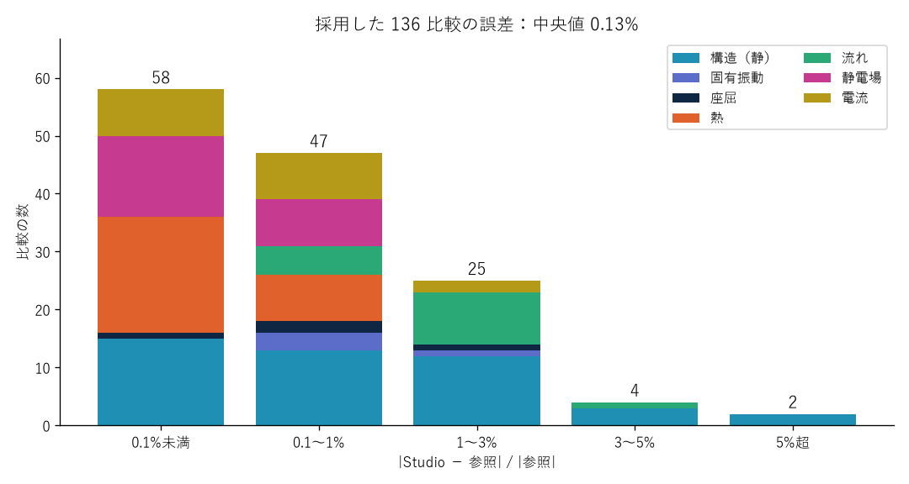
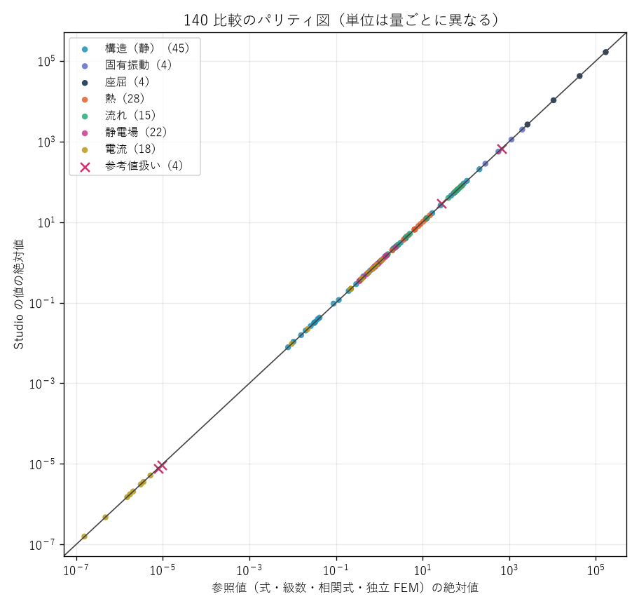
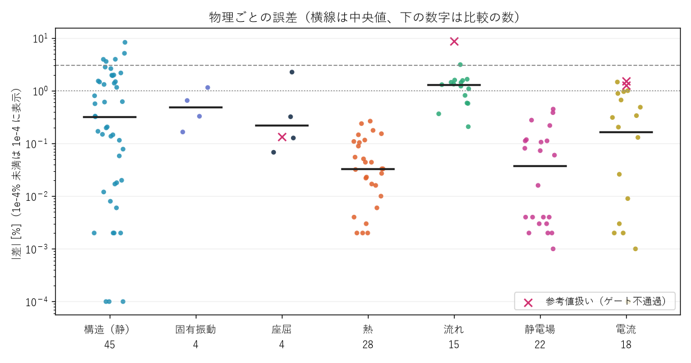

AI エージェントに解析ソフトを操作させた記事は増えてきましたが、「何件解いて、教科書の答えと何%ずれたか」を全件で出したものは見かけません。

NovaSolver Studio（無料・オープンソースの解析ソフト）の MCP サーバを、Claude Code が書いた Python のスクリプトから呼び、構造・熱・流れ・静電場・電流の解析を回しました。参照値（式・級数・相関式・独立した 2 次元 FEM）と比べたのは **121 解析・140 比較**。この記事では集計を示し、[全行 CSV](cases.csv) の `studio_value_from`・`reference_from` 列に出典を記します。

採用した 136 比較のうち、|差| が 1% 未満は 105、3% 未満は 130。中央値は 0.13%、平均は 0.63% でした。

## 何をしたか

| 項目 | 値 |
|---|---|
| MCP の呼び出し | 3,355 回（ログ 49 ファイル） |
| ログに出てくるケース ID | 206 |
| 計算を始めたもの | 187 |
| 完了したもの | 171（開始 187 件からメモリ不足 11、非収束のジョブ失敗 3、ツールエラー 1、完了未確認 1 を除く） |
| 3 段階のメッシュ試験を完了 | 167（合格 145、不合格 22）。別に単一メッシュの円管 4 |
| 開始前に RED で拒否 | 8（開始 187 件の外） |
| 参照値と比べた解析 | 121 解析・140 比較 |
| うち採用 | 118 解析・136 比較 |
| うち参考値扱い（ゲート不通過） | 3 解析・4 比較 |

操作の実態を正確に書いておきます。Claude Code が書いたのは MCP の呼び出しを並べた Python スクリプトで、形状の STEP ファイル、参照値を計算するスクリプト、比較のスクリプトも Claude Code が書きました。集計には MCP の記録 JSONL、参照 JSON に加え、評価 JSON と旧記事表からの転記値も含みます。新しい計算は追加していません。

差率は原則として参照値の大きさを分母にします。ただしカップの 5 比較は ℃ の数値を分母とし、温度上昇 K の比較と混在します。

1 解析で 2 つの量を比べたもの（偏心同軸の静電容量と電界など）があるので、解析数より比較数が多くなっています。

## パリティ図

量も単位もばらばらなので、符号を除いた大きさの両対数で並べています。10⁻⁷ Ω の接触抵抗から 10⁵ N の座屈荷重まで、12 桁の範囲です。✕ はメッシュ収束ゲートを通らず参考値扱いにした 4 比較です。

両対数のパリティ図は、差が数%あってもほとんど線の上に見えます。この図で分かるのは「桁を外したものはない」ことだけで、精度は次の表で見ます。

## 物理ごとの誤差

| 物理 | 比較 | 中央値 | 最大 | 1% 未満 |
|---|---|---|---|---|
| 構造（静解析） | 45 | 0.32% | 8.29% | 28 |
| 固有振動 | 4 | 0.49% | 1.15% | 3 |
| 座屈 | 4 | 0.22% | 2.26% | 3 |
| 熱 | 28 | 0.033% | 0.27% | 28 |
| 流れ | 15 | 1.30% | 3.13% | 5 |
| 静電場 | 22 | 0.038% | 0.45% | 22 |
| 電流 | 18 | 0.17% | 1.46% | 16 |

熱と静電場は 50 比較すべてが 1% 未満でした。流れは中央値 1.3% で、物理の中で最も大きくなりました。相関式（実験をまとめた曲線）との比較も含むため、その前提の違いが要因として考えられます。

## 参照値の種類ごとの誤差

| 参照値 | 比較 | 中央値 | 最大 |
|---|---|---|---|
| 独立した FEM（2 次元 FEM、同じ形の別メッシュ） | 14 | 0.013% | 0.57% |
| 式（解析解・設計式） | 101 | 0.12% | 8.29% |
| 級数（Navier、Shah & London、Roess、Bessel など） | 16 | 0.29% | 2.81% |
| 相関式（球の標準抵抗曲線） | 5 | 1.30% | 3.13% |

差の大きさは、Studio の誤差だけでなく、参照値の前提の強さも映しています。式の最大 8.29% は、薄肉を前提にした式を肉厚の管に当てたものです（次節）。独立した FEM の 14 比較のうち 4 つは、穴あき板を別のメッシュで解いたメッシュの確認です。

符号の偏りはほとんどありません。136 比較のうち Studio が大きいのが 64、小さいのが 67、一致が 5 でした。

## テーマ別の全データ

| 物理 | テーマ | 比較 | 中央値 | 最大 | 参照値 |
|---|---|---|---|---|---|
| 構造 | C 形リングの内側の応力 | 2 | 1.07% | 1.99% | 曲がり梁の式 |
| 構造 | はりのたわみ | 5 | 0.32% | 0.80% | 式 |
| 構造 | 回転円板の穴の縁の応力 | 6 | 0.048% | 0.14% | 式 |
| 構造 | 穴あき板の Kt | 10 | 0.86% | 3.94% | Heywood の式、別メッシュ |
| 構造 | 切れ目入りの管のねじれ | 6 | 1.98% | 8.29% | Vlasov の式 |
| 構造 | 棚板のたわみ | 4 | 1.51% | 3.59% | はりの式 |
| 構造 | 厚肉円筒（Lamé） | 6 | 0.007% | 0.02% | Lamé の式 |
| 構造 | ガラス板のたわみ | 6 | 1.62% | 2.81% | Navier 級数 |
| 固有振動 | チャイムの棒 | 4 | 0.49% | 1.15% | 自由-自由はりの式 |
| 座屈 | 鋼の柱（800 mm は参考扱い） | 4 | 0.22% | 2.26% | オイラーの式 |
| 熱 | カップの外側の温度 | 5 | 0.003% | 0.006% | 円筒壁＋熱伝達の式 |
| 熱 | ピンフィンの放熱量 | 10 | 0.13% | 0.27% | フィンの式 |
| 熱 | 電線の被覆 | 7 | 0.022% | 0.051% | 式 |
| 熱 | 熱拡散板 | 6 | 0.030% | 0.044% | 級数 |
| 流れ | 細い管の圧力勾配 | 5 | 1.45% | 1.59% | Hagen-Poiseuille |
| 流れ | 球の抗力 | 5 | 1.30% | 3.13% | 標準抵抗曲線 |
| 流れ | 長方形ダクトの f·Re | 5 | 0.57% | 1.09% | 式・Shah & London |
| 静電場 | 同軸の静電容量など | 12 | 0.038% | 0.45% | 式 |
| 静電場 | 偏心同軸 | 10 | 0.039% | 0.12% | 式（鏡像法） |
| 電流 | 配線の直角の角 | 2 | 0.32% | 0.34% | 独立 2 次元 FEM |
| 電流 | 接点の絞り抵抗 | 8 | 0.78% | 1.46% | Holm・Roess |
| 電流 | van der Pauw | 8 | 0.002% | 0.026% | 独立 2 次元 FEM |

細い管の 5 本のうち 4 本は 1 回の計算だけで、メッシュ収束は直径 5 mm の 1 本（GCI 0.82%）でしか確かめていません。

## 1% を超えた 31 比較

| テーマ | 条件 | Studio | 参照 | 差 |
|---|---|---|---|---|
| 切れ目入りの管 | L = 100 mm、ねじれ角 | 0.0950° | 0.0878° | +8.29% |
| 切れ目入りの管 | L = 200 mm | 0.452° | 0.429° | +5.13% |
| 切れ目入りの管 | L = 400 mm | 1.424° | 1.370° | +3.95% |
| 穴あき板 | d/W = 0.6、Kt | 2.1453 | 2.064 | +3.94% |
| 棚板 | 中央に仕切り、最大たわみ | 0.0394 mm | 0.0381 mm | +3.59% |
| 球の抗力 | Re = 10、Cd | 4.392 | 4.258 | +3.13% |
| ガラス板 | 300×300 mm、中央のたわみ | 0.010779 mm | 0.01048 mm | +2.81% |
| 穴あき板 | d/W = 0.5 | 2.1809 | 2.125 | +2.63% |
| 鋼の柱 | L = 50 mm、座屈荷重 | 164.8 kN | 168.6 kN | −2.26% |
| 穴あき板 | d/W = 0.4 | 2.2642 | 2.216 | +2.18% |
| ガラス板 | 300×450 mm | 0.020327 mm | 0.01993 mm | +1.97% |
| C 形リング | 内側の応力 | 90.47 MPa | 88.70 MPa | +1.99% |
| ガラス板 | 424×424 mm | 0.042639 mm | 0.04183 mm | +1.93% |
| 球の抗力 | Re = 20 | 2.760 | 2.715 | +1.66% |
| 細い管 | d = 4 mm、圧力勾配 | 12.64 Pa/m | 12.44 Pa/m | +1.59% |
| 細い管 | d = 5 mm | 5.176 Pa/m | 5.096 Pa/m | +1.57% |
| 棚板 | 24 mm の板、置くだけ | 0.628 mm | 0.619 mm | +1.53% |
| 棚板 | 両端固定 | 0.289 mm | 0.293 mm | −1.49% |
| 穴あき板 | d/W = 0.3 | 2.3774 | 2.343 | +1.47% |
| 接点 | 半径 6 mm、絞り抵抗 | 0.1582 µΩ | 0.1559 µΩ | +1.46% |
| 細い管 | d = 6 mm | 2.493 Pa/m | 2.458 Pa/m | +1.45% |
| 細い管 | d = 8 mm | 0.7888 Pa/m | 0.7776 Pa/m | +1.44% |
| 棚板 | 18 mm の板、置くだけ | 1.487 mm | 1.467 mm | +1.39% |
| ガラス板 | 300×600 mm | 0.026484 mm | 0.02614 mm | +1.32% |
| 細い管 | d = 3 mm | 39.85 Pa/m | 39.32 Pa/m | +1.34% |
| 球の抗力 | Re = 50 | 1.595 | 1.574 | +1.30% |
| 球の抗力 | Re = 100 | 1.100 | 1.087 | +1.22% |
| 穴あき板 | d/W = 0.2 | 2.5411 | 2.512 | +1.16% |
| チャイムの棒 | L = 150 mm、第 1 曲げ振動数 | 1,977.1 Hz | 2,000.1 Hz | −1.15% |
| 長方形ダクト | 縦横比 1:8、f·Re | 81.44 | 82.34 | −1.09% |
| 接点 | 半径 2 mm、絞り抵抗 | 1.496 µΩ | 1.511 µΩ | −1.00% |

31 のうち 26 で Studio の値が参照値より大きく出ています。全 136 比較では符号の偏りがないので、偏りは「差が大きいもの」に限った話です。穴あき板の Kt は穴が大きいほど、切れ目入りの管は短いほど差が大きく、どちらも参照式の前提から離れる方向です。

## 3% を超えた 6 比較と、原因候補

| 比較 | 差 | 記録にある原因候補 |
|---|---|---|
| 切れ目入りの管 L = 100 / 200 / 400 mm（3 比較） | +8.3% / +5.1% / +4.0% | 肉厚が半径の約 2 割あり、薄肉を前提にした Vlasov の式から外れる。短い管ほど差が大きい。St-Venant の式とは −81〜−27% |
| 穴あき板 d/W = 0.6 | +3.9% | 2 次元（平面応力）の式と、3 次元 FEM のミーゼス応力の比較。Peterson の式とは +1.9% |
| 棚板・中央に仕切り | +3.6% | 3 次元の板を、はりの式と比べている |
| 球 Re = 10 | +3.1% | 実験をまとめた曲線との差。Studio 内蔵の Schiller-Naumann との照合は +5.79%（許容 8%）で合格 |

参照式との前提の違いが原因候補として記録されていますが、離散化誤差との寄与は分離していません。穴あき板の GCI 対象は最大変位で、Kt や局所応力ではありません。

ガラス板は中央点の uz で比較し直しました。300×300 mm の +2.81% について、3 次元の支持条件の違いが要因として考えられますが、寄与は分離していません。

## 参考値扱いにした 4 比較

| 比較 | 差 | ゲート |
|---|---|---|
| 球 Re = 1、Cd | +8.8% | GCI 7.6%（許容 5%）で不合格。Cd が 28.78 → 28.96 → 29.54 と増え続けた |
| 接点 半径 0.5 mm、全抵抗 | −1.27% | GCI 4.6% だが、細かくするたびに約 0.8% 増え、Studio の次数基準未達 |
| 接点 半径 0.5 mm、絞り抵抗 | −1.53% | 同上 |
| 柱 L = 800 mm | +0.13% | GCI 0.18% でもソルバー未収束で不合格 |

接点の 2 比較は、参照値との差だけ見れば 1.6% 未満で、ほかの接点と変わりません。それでもメッシュの条件を満たさないため、採用分から外しています。**差が小さいことと、答えが定まっていることは別です。**

## 採用の基準

比較を「採用」にした条件は次のとおりです。

- 計算が完了し、ソルバーが収束した
- 原則として GCI の許容値・細分化・次数などの判定条件を満たした。単一メッシュの円管は例外として残し、柱 50 mm は GCI 合格だが参照照合 FAIL（オイラーの式と −2.26%、せん断変形式と +0.25%）を明記して採用した
- 設定が意図どおりだった（穴あき板は更新拒否を見落とした旧バッチを除外。完走 3 件中、寸法の取り違えは 2 件。棚板も旧バッチを除外し、支持の取り違えは 2 件）

ゲートを通ったのに採用しなかった解析は 30 件あります。多くは、同じ組の一部が不合格だったので、条件をそろえて組全体を解き直した分です。

## まとめ

- AI が書いたスクリプトで MCP から回した 136 比較で、誤差の中央値は 0.13%、1% 未満は 105、3% 未満は 130
- 熱と静電場の 50 比較はすべて 1% 未満。流れは相関式との比較を含み、中央値 1.3%
- 3% を超えた 6 比較は、参照式の前提（薄肉、2 次元、はり、実験曲線）との違いが原因候補として記録にある
- メッシュ収束ゲートを通らなかった 4 比較は、差が小さくても参考値扱いにした

計算は 2026-11-06〜12 に、Studio のソースツリーから起動した開発版で行いました。

---

NovaSolver Studio は無料のオープンソース（GPL-3.0）です。構造・熱・流れ・静電場・電流を 1 つのアプリで解け、Claude Desktop などの MCP クライアントから操作できます。

- 紹介・ダウンロード：https://novasolver.jp/studio/
- ソースコード（GitHub）：https://github.com/novasolver/novasolver-studio
