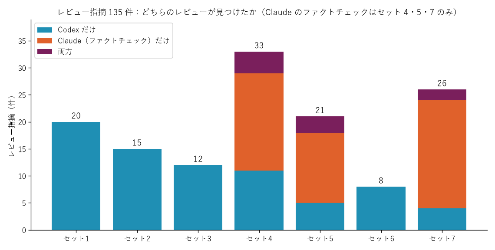
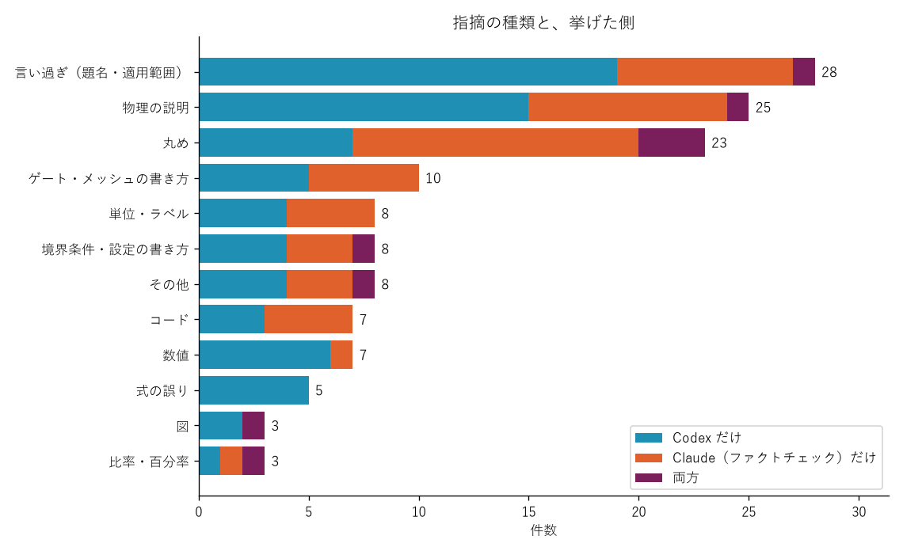

AI に技術記事を書かせると、数字は合っているのに、題名が言い過ぎていたり、比率の分母が逆になっていたりします。人が全部読み直すのは重いので、別の AI にレビューさせる、という手が考えられます。

NovaSolver Studio（無料・オープンソースの解析ソフト）の解析記事 7 セット分で、これを実際に回しました。書いたのは Claude Code、確かめたのは別の Claude エージェントと Codex（GPT 系）です。レビュー指摘（任意の改善提案を含む）は **135 件**。そのうち、2 つのレビューが同じ箇所を挙げたのは **9 件**だけでした。



この記事では、パイプラインの作りと、135 件の内訳、影響の大きかった誤りを並べます。

## パイプライン

| 段 | 担当 | やったこと | 残したもの |
|---|---|---|---|
| 解析 | Claude Code | MCP の呼び出しを並べた Python スクリプトを書き、Studio を動かした。参照値の計算スクリプトも書いた | 呼び出しと返答をそのまま記録した JSONL、参照値の JSON |
| 執筆 | Claude Code | ログと参照値から記事と図を書いた | 原稿、図、図のスクリプト |
| ファクトチェック | 別の Claude エージェント（セット 4・5・7） | 原稿の数字を、ログと参照値から Python で計算し直した | review_claude_set*.md |
| レビュー | Codex（読み取り専用、全 7 セット） | 原稿・図・ログ・参照計算・Studio のソースを照合した | review_codex_*.md |
| 反映 | Codex（書き込みあり、別のスクリプト） | Codex の指摘を原稿と図に反映し、反映の記録を残した（セット 4〜7） | apply_codex_*.md |

Codex には、前段の Claude のファクトチェック結果を「反映済み」として渡し、すでに直った指摘は繰り返さず、独立に判断するよう指示しています。Codex を呼ぶ PowerShell スクリプトの冒頭はこうです。

```powershell
# Codex fact review of a set of topic articles (read-only), generic: pass -Tag -Evidence -Prior -Articles.
param([string]$Tag = 'set5', [string]$Evidence = 'evidence5', [string]$Prior = 'review_claude_set5.md', ...)
```

プロンプトでは、証拠のファイル（`*.jsonl` は MCP の呼び出しの記録、`refs*.py` は参照値の計算、`*_rejected_*` は記事に使っていない試行）を説明し、数字・丸め・比率・物理の説明・境界条件・式の条件を照合させました。

## 135 件の内訳

| 項目 | 件数 |
|---|---|
| 合計 | 135 |
| 重要度 高 / 中 / 低 | 9 / 61 / 65 |
| 見つけた側：Codex だけ / Claude だけ / 両方 | 75 / 51 / 9 |
| 旧 7 セットの台帳上の反映：済み / 一部 / 未反映 / 判定できず | 112 / 6 / 4 / 13 |

セットごとの件数は、1＝20、2＝15、3＝12、4＝33、5＝21、6＝8、7＝26 です。

数字の比較には注意が要ります。**Claude のファクトチェックはセット 4・5・7 だけで行い、Codex は全 7 セットを見ています。**「Codex だけ 75 件」のうち 55 件は、Claude のファクトチェックがなかったセットのものです。

両方が走った 3 セットに限ると、次のようになります。

| セット 4・5・7 | 件数 |
|---|---|
| Claude が挙げた | 60 |
| Codex が挙げた（Claude の指摘を反映した後の原稿に対して） | 29 |
| うち両方が挙げた | 9 |

Codex は Claude の後に走っているので、Codex の 20 件（29 − 9）は、Claude のファクトチェックを通った後に追加で得られた指摘です。同じ原稿への独立レビューではなく、見落とし率やモデルの優劣は判断できません。両方が挙げた 9 件には、Claude の直し方が不十分で、Codex がもう一度挙げたものが含まれます（後述の接点の例）。

## 指摘の種類



| 種類 | 全体 | セット 4・5・7 での Claude だけ / Codex だけ / 両方 |
|---|---|---|
| 言い過ぎ（題名・適用範囲） | 28 | 8 / 7 / 1 |
| 物理の説明 | 25 | 9 / 1 / 1 |
| 丸め | 23 | 13 / 2 / 3 |
| ゲート・メッシュの書き方 | 10 | 5 / 0 / 0 |
| 境界条件・設定の書き方 | 8 | 3 / 1 / 1 |
| 単位・ラベル | 8 | 4 / 2 / 0 |
| 数値 | 7 | 1 / 1 / 0 |
| コード | 7 | 4 / 1 / 0 |
| 式の誤り | 5 | 0 / 4 / 0 |
| 比率・百分率 | 3 | 1 / 0 / 1 |
| 図 | 3 | 0 / 1 / 1 |
| その他 | 8 | 3 / 0 / 1 |

指摘の分類で最も多いのは数値ではなく、**言い過ぎ**（28 件）と**物理の説明**（25 件）でした。数字に意味をつける部分への指摘が多くありました。

セット 4・5・7 の丸めの指摘は、Claude だけ 13 件、Codex だけ 2 件、両方 3 件でした。式そのものの誤りは Codex だけ 4 件、Claude だけ 0 件です。これは今回の逐次レビューでの内訳です。

## 影響の大きかった誤り

### 1. 熱拡散板：参照式の二重加算（Codex だけが発見）

熱拡散板の記事では、Lee らの 1995 年の原論文にはない ετ/√π の項を近似式の ψmax に入れ、板厚方向の 1 次元伝導の抵抗を 2 回足していました。熱源が全面（ε = 1）でも拡がり抵抗が残る形です。

| | 修正前 | 修正後 |
|---|---|---|
| 式 | ψmax = ετ/√π + … | ψmax = (1 − ε)Φc/√π |
| 厚さ 20 mm の温度上昇 | 6.88 K | 6.62 K |
| 厳密解との差 | 4.3% 高い | 約 0.47% 高い |

厄介なのは、**参照値を計算するスクリプト（refs7.py）と図のスクリプトにも同じ誤りが入っていた**ことです。書いた AI が参照値も作っているので、原稿と参照値が同じ誤りで一致してしまいます。Claude のファクトチェックは「原論文と一致」と判定して見逃し、Codex が見つけました。

### 2. 管の題名：「押す力は 16 分の 1」

直径を 2 倍にすると、同じ流量に必要な圧力勾配は 1/16 になります。ところが断面にかかる力 F = ΔpA は、面積が 4 倍になるので 1/4 です。題名が圧力と力を混同していました。Codex が指摘し、「必要な圧力勾配は 16 分の 1」に直しています。

### 3. C 形リング：22% の分母が逆

原稿は「曲がり梁の式は直線梁の式より 22% 大きい」と書いていました。実際は、曲がり梁の式 89.4 MPa は直線梁の式 70.0 MPa より約 28% 大きく（FEM の 90.5 MPa は約 29%）、22% は「直線梁の式が低く出る割合」です。Codex が指摘し、「直線梁の式は 22% 低い値」に直しました。

### 4. まとめ記事：40 ケースと 42 条件

まとめの記事は「40 ケースを解いて」と書き、各テーマの最大差を図にしていました。実際に完了したのは 42 条件で、40 はゲートを通らなかった 2 件（球 Re = 1、接点 0.5 mm）を断らずに除いた数です。含めると最大差は球の約 8.8% になります。Codex の指摘で、42 条件と除外の理由を明記しました。

### 5. 接点：レビュー側の直しも誤っていた（両方）

接点の記事は「Holm の式と 0.7% 以内」と書いていましたが、これは棒の抵抗を含む合計での差でした。Claude のファクトチェックは「1.3% 以内」に直すよう提案しましたが、Codex が丸める前の値で計算し直し、最大 +1.464%（約 1.5%）と特定しました。**レビューする AI の直しも、別のレビューで確かめる必要がある**例です。

## 分かったこと

**1. 指摘は数字より言葉に多い。** 言い過ぎと物理の説明で 53 件、全体の 39%。数字を照合するだけのチェックでは、ここが抜けます。

**2. 今回の逐次レビューでは追加指摘が得られた。** 同じ 3 セットで重なったのは 9 件ですが、レビュー順序も影響するため、モデル固有の得意分野は判定できません。

**3. 書いた AI が作った参照値は、独立していない。** Lee の式の誤りは、原稿・参照スクリプト・図の 3 か所に同じ形で入っていました。原稿と参照値が一致していても、それは同じ AI が 2 回同じことをしただけかもしれません。参照値の計算は、式の出典まで戻って確かめる工程が要ります。

**4. 反映も記録する。** 旧 7 セットの原稿を対象にした台帳では、反映 112、一部 6、未反映 4、不明 13 件です（反映の記録 apply_codex_*.md はセット 4〜7 のみ）。今回の原稿の現状を表す数ではありません。管の +1.4% は現在、同区間の評価コードと pipe_fine.json が支持しています。指摘の一覧と現行の原稿を突き合わせる工程を、レビューと同じ重さで置く必要があります。

**5. 重要度の高い誤りは、少数だが記事の主張を変える。** 高の 9 件の多くは、題名（力と圧力）、結論の比率（22%）、参照値そのもの（Lee の式）、母数（40 と 42）など、記事が言いたいことの中心にありました。

## 再現したい人へ

構成要素は単純です。

- 書く AI には、MCP の呼び出しと返答をそのまま JSONL に残させる（記事の数字の出どころを 1 つにする）
- ファクトチェックの AI には、その JSONL と参照値から数字を計算し直させる
- 次のレビューには、前段の結果を「反映済み」として渡し、繰り返さず独立に判断させる。参照値のスクリプトとツールのソースまで読ませる
- 反映は「どの指摘を、どの行で直したか」を記録させる

---

NovaSolver Studio は無料のオープンソース（GPL-3.0）です。構造・熱・流れ・静電場・電流を 1 つのアプリで解け、Claude Desktop などの MCP クライアントから操作できます。

- 紹介・ダウンロード：https://novasolver.jp/studio/
- ソースコード（GitHub）：https://github.com/novasolver/novasolver-studio
