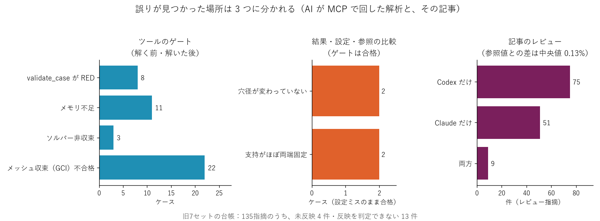

設計の現場で、AI エージェントに強度や熱の解析を任せる話が現実になってきました。そのときよく出る問いが「AI が出した解析結果の責任は誰が持つのか」です。

この問いは、抽象的に議論すると「最後は人が責任を持つ」で終わります。それは正しいのですが、人が何を見ればよいかは分かりません。

ここでは、実際に AI が回した解析の記録から考えます。NovaSolver Studio（無料・オープンソースの解析ソフト）の MCP サーバを、Claude Code が書いた Python のスクリプトから **3,355 回**呼び、構造・熱・流れ・静電場・電流の解析を回しました。参照値と比べた 136 比較の差は、中央値 0.13% です。

数字だけ見れば上出来です。しかし、誤りは数字の外に、3 つの場所に分かれて見つかりました。

## 1. ツールのゲートが止めたもの

計算開始前の RED 拒否は 8 件で、開始 187 件とは別枠です。開始分は結果あり 171 件、メモリ不足 11 件、非収束のジョブ失敗 3 件、ツールエラー 1 件、完了未確認 1 件でした。

| ゲート | 件数 |
|---|---|
| validate_case が RED（解けない設定） | 8 |
| メモリ不足 | 11 |
| ソルバー非収束 | 3 |
| メッシュ収束（GCI）不合格 | 22（メッシュ判定 21、ソルバー未収束の柱 1） |

これらには、AI が再実行・設計変更・中止・参考扱いで対応しました。返答に「温度を決める面がありません」「約 4.8 GB 必要、使えるのは約 4.3 GB」と書かれていれば、スクリプトを直して解き直せます。23 テーマのうち 13 テーマで、少なくとも 1 回のやり直し・設計変更・中止がありました。

ここで言えるのは、**数値の健全性は、ツールが機械的に判定できる**ということです。メッシュが本当に細かくなったか、差が縮んでいるか、メモリが足りるか。これを AI の自己申告に任せる理由はありません。

## 2. ゲートを全部通った誤り

一方で、ゲートを全部通った設定ミスが 2 系統、計 4 ケース（穴径 5・15 mm の 2 件と棚板の 2 件）ありました。

| 解析 | 意図 | 実際 | ゲート |
|---|---|---|---|
| 穴あき板 | 穴径 5・10・15 mm | 変更が拒否されたまま、3 ケースとも既定の 10 mm で解かれた（取り違えは 5・15 mm の 2 件） | GCI・参照照合とも合格 |
| 棚板 | 両端に置くだけ | 下面の端 10 mm を拘束し、ほぼ両端固定になった（2 ケース） | GCI 0.99% / 1.3% で合格 |

穴あき板は、サーバが変更を拒否したのに、スクリプトが返答を読まずに先へ進んだものです。棚板は、そもそもツールに見分けようがありません。「端の帯を固定する」は正当な設定で、意図が「置くだけ」だったかどうかは、頼んだ側にしか分からないからです。

AI が気づいた手掛かりは、穴あき板では条件間の結果比較と更新拒否の確認、棚板でははり式との比較でした。穴あき板は、穴径を変えたのに応力集中係数 Kt が 3 回とも 2.5411 だったこと。棚板は、はりの単純支持の式 1.467 mm に対して 0.346 mm と、約 1/4 だったことです。

ここで言えるのは、**ゲートの合格は「解いた問題が正しい」ことを意味しない**ということです。Studio の MCP サーバ自身が、AI への指示で「どの確認も、境界条件・材料・実物はカバーしない」「どのゲートも、設計が安全だという意味ではない」と明言しています。ゲートは「問題をきちんと解いたか」を見ており、「正しい問題を解いたか」は見ていません。

## 3. 記事のレビューが見つけたもの

解析の結果を記事にしたところ、別の Claude エージェントのファクトチェックと Codex（GPT 系）のレビューで、任意の改善提案を含むレビュー指摘が **135 件**記録されました。Claude の指摘を反映した後に Codex が見る逐次レビューです。

| 種類 | 件数 |
|---|---|
| 言い過ぎ（題名・適用範囲） | 28 |
| 物理の説明 | 25 |
| 丸め | 23 |
| ゲート・メッシュの書き方 | 10 |
| そのほか | 49 |

数値に分類された指摘は 7 件でした。多いのは、数字に意味をつけるところの誤りです。「直径を 2 倍にすると押す力は 1/16」（実際は圧力勾配が 1/16、力は 1/4）。「40 ケースを解いた」（実際は 42 条件で、ゲートを通らなかった 2 件を断らずに除いていた）。

さらに、レビュー側にも誤りがありました。熱拡散板の参照式の誤りは、Claude のファクトチェックが「原論文と一致」と判定して見逃し、Codex が見つけました。その誤りは、AI が作った参照値のスクリプトにも同じ形で入っていました。接点の記事では、Claude が提案した直し（1.3% 以内）も誤っていて、Codex が最大 1.464% と特定しています。

2 つのレビューが同じ箇所を挙げたのは 9 件だけでした。旧 7 セットの台帳上の反映分類は、反映 112、一部 6、未反映 4、不明 13 件です。今回の原稿の現状を表す数ではありません。管の +1.4% は現在、同区間の評価コードと pipe_fine.json が支持しています。

ここで言えるのは、**主張の正しさは、数値の正しさとは別に確かめる必要がある**ということです。数字が 0.13% で合っていても、その数字から何を言うかで間違えます。

## 責任をどこに置くか

3 つの場所で、異なる手掛かりから問題が見つかりました。そこで、責任を 1 か所に集めるのではなく、**誤りが見える場所ごとに分けて置く**ことを提案します。

| 置き場所 | 責任を持つこと | 今回のデータでの根拠 |
|---|---|---|
| ツール | 数値の健全性（解けるか、収束したか、メッシュ誤差は許容内か）。合格を強い言葉に言い換えさせない | メッシュ判定 21 件を含む 43 件を検出し、再実行・設計変更・中止・参考扱いで対応。別に 800 mm 柱は未収束で不合格 |
| 独立した参照 | 解いた問題が意図どおりか。書いた AI とは別の経路で作る | 設定ミスは穴あき板で条件間の結果比較・更新拒否の確認、棚板ではり式との比較から発見した。AI が作った参照スクリプトには、原稿と同じ誤りが入っていた |
| レビュー | 数字から言っていること（題名、比率、適用範囲）。2 系統以上で、反映まで記録する | 逐次レビューの 135 指摘のうち重なりは 9 件。レビュー側の直しも誤ることがあった |
| 人 | 何を解くか（意図）と、結果を採るかどうか | 「置くだけ」かどうかは、頼んだ側にしか分からない |

### ツールに置くもの

数値の健全性は、AI にも人にも任せず、ツールに判定させるべきです。今回、GCI が 4×10⁻¹¹% なのに不合格になった例がありました。3 段階のメッシュが同じで、何も確かめていなかったからです。数字を見て「完璧に収束」と書くのは、AI でも人でもやりかねません。

そしてツールは、合格を言い換えさせないことまで責任を持つべきです。「メッシュ収束（GCI）に合格」は、「解析が正しい」ではありません。AI は要約で言葉を強めがちです。

### 独立した参照に置くもの

穴あき板では条件間の結果比較と更新拒否の確認が手掛かりでした。式、級数、2 次元の FEM、同じ形の別メッシュとの比較も、意図や前提の違いに気づく助けになります。

ただし、参照値も AI が作るなら、独立とは限りません。熱拡散板では、原稿と参照スクリプトと図が、同じ誤った式で一致していました。参照値は「書いた AI と別の経路」で作り、式の出典まで戻って確かめる必要があります。

### レビューに置くもの

今回の台帳では、数字より言葉への指摘が多くありました。言い過ぎと物理の説明だけで 53 件、全体の 39% でした。

今回の逐次レビューでは追加指摘が得られました。同じ原稿への独立レビューではないため、モデル固有の得意分野や見落とし率、優劣は判断できません。そして、指摘を出しただけでは直りません。反映を「どの指摘を、どの行で直したか」まで記録しないと、13 件のように後から判定できなくなります。

### 人に残るもの

ここまで分けても、人に残るものがあります。**何を解くか、という問題の定義**です。

棚板の「置くだけ」は、どのツールにも、どのレビューにも、意図として渡されていなければ判定できません。AI は、渡された意図とずれていることには気づけます（今回も式との比較で気づきました）。しかし、意図そのものが正しいかは、設計の目的を知っている人にしか分かりません。

そしてもう 1 つ、結果を採るかどうか。ゲートを通らなかった球 Re = 1、接点 0.5 mm、800 mm 柱は、参照値との差が小さく見えても（接点は −1.3% と −1.5%）、参考値扱いにしました。差が小さいことと、答えが定まっていることは別です。この線引きを決めるのは、結果を使う側です。

## まとめ

- AI が回した 136 比較で、参照値との差は中央値 0.13%。数値の面では参照値とよく合っていた
- それでも、ゲートを全部通った設定ミスが 2 系統・4 ケースあり、記事には 135 件のレビュー指摘があった
- 誤りは「ツール」「独立した参照」「レビュー」の 3 か所でそれぞれ見つかり、異なる手掛かりが得られた
- 検証の責任は、1 か所に集めるのではなく、誤りが見える場所ごとに置く。人には、問題の定義と採否が残る

AI が解析をする時代に、検証の仕事は減りません。どこで何を確かめるかを、先に設計しておく仕事に変わります。

---

NovaSolver Studio は無料のオープンソース（GPL-3.0）です。構造・熱・流れ・静電場・電流を 1 つのアプリで解け、Claude Desktop などの MCP クライアントから操作できます。

- 紹介・ダウンロード：https://novasolver.jp/studio/
- ソースコード（GitHub）：https://github.com/novasolver/novasolver-studio
