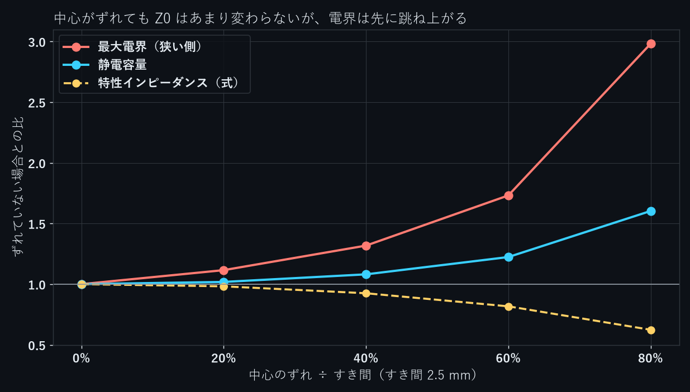
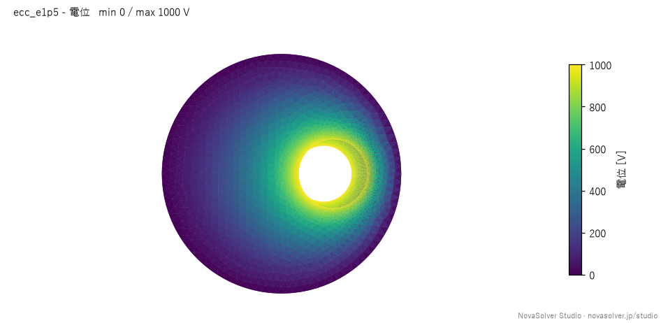

同軸ケーブルの内導体は、製造のばらつきで中心からずれることがあります。ずれると静電容量が増え、特性インピーダンス $Z_0$ が下がります。ただ、$Z_0$ の変化は小さく、先に大きく変わるのは内導体の表面の電界です。

内導体の半径 1 mm、外導体の内半径 3.5 mm、すき間 2.5 mm、絶縁体は PTFE（比誘電率 2.1）の同軸を考えます。内導体を 0〜2 mm ずらした5ケースを、NovaSolver Studio の静電場解析で解き、式と比べました。

## 結果

内導体に 1000 V、外導体に 0 V をかけ、長さ 10 mm 分を解いています。静電容量はこの 10 mm 分の値です。

| ずれ | ずれ÷すき間 | 静電容量 Studio | 式 | $Z_0$ | 狭い側の電界 Studio | 式 | 広い側の電界 Studio |
|---|---|---|---|---|---|---|---|
| 0 | 0% | 0.9326 pF | 0.9326 pF | 51.8 Ω | 0.797 kV/mm | 0.798 | 0.798 |
| 0.5 mm | 20% | 0.9497 pF | 0.9496 pF | 50.9 Ω | 0.889 kV/mm | 0.890 | 0.741 |
| 1.0 mm | 40% | 1.0082 pF | 1.0082 pF | 47.9 Ω | 1.051 kV/mm | 1.052 | 0.708 |
| 1.5 mm | 60% | 1.1412 pF | 1.1412 pF | 42.4 Ω | 1.380 kV/mm | 1.381 | 0.691 |
| 2.0 mm | 80% | 1.4945 pF | 1.4945 pF | 32.3 Ω | 2.377 kV/mm | 2.380 | 0.687 |

静電容量は5ケースとも式との差が 0.02% 以内、狭い側の電界は 0.12% 以内でした。$Z_0$ は Studio の静電容量から $Z_0 = \sqrt{\varepsilon_r}/(c\,C')$ で求めています（$C'$ は1 m あたりの容量）。

ずれがすき間の 40% のとき、$Z_0$ は 51.8 Ω → 47.9 Ω で約7.5%低下します。一方、狭い側の電界は 32% 上がります。20% のずれでも、$Z_0$ は 2% しか変わらないのに、電界は 12% 上がります。広い側の電界は少し下がりますが、一定の絶縁破壊電界を仮定するモデルでは、最大電界との比較が重要です。


*ずれ 1.5 mm（すき間の 60%）の電位分布。内導体は右（+x）にずれている*

## 式

静電容量は、偏心した2円筒の式で表せます。

$$
C' = \frac{2\pi\varepsilon_0\varepsilon_r}{\operatorname{arccosh}\!\left(\dfrac{a^2 + b^2 - e^2}{2ab}\right)}
$$

$a$ は内導体の半径、$b$ は外導体の内半径、$e$ は中心のずれです。$e = 0$ で、おなじみの $2\pi\varepsilon/\ln(b/a)$ に戻ります。

表面の電界は、2本の線電荷を置いて両方の円が等電位になるようにする方法（鏡像法）で求めました。線電荷の位置 $p_1$（内導体の内側）と $p_2 = b^2/p_1$ は、次の2次方程式の解です。

$$
e\,p^2 + (a^2 - b^2 - e^2)\,p + e\,b^2 = 0
$$

静電容量の式では $e$ が $e^2$ の形で現れるので、ずれが小さいうちは、容量はずれの2乗でしか変わりません。一方、狭い側のすき間は $b - a - e$ で、ずれに比例して狭くなります。小さなずれで先に効いてくるのが電界のほうなのは、このためです。

## Studio での計算

形は、内導体の位置だけを変えた STEP ファイルを5つ用意し、MCP から読み込んで電圧をかけました。以下は主要な呼出しの抜粋です（ID・面ID取得、入力確認、`job_status` による完了待ちは省略）。

```python
t = import_geometry(path="ecc_e1p0.step", physics="electrostatic", units="mm")
# 円筒面2つのうち、面積の小さいほうが内導体
update_case(case_id=cid, expected_revision=1, changes={
    f"boundaries.{inner}.role": "voltage", f"boundaries.{inner}.voltage": "1000 V",
    f"boundaries.{outer}.role": "voltage", f"boundaries.{outer}.voltage": "0 V",
    f"mesh.refine.{inner}": "0.1 mm",
})
check_convergence(case_id=cid)    # 3段階のメッシュで解く
probe_results(case_id=cid, points=[[e + 1.0005, 0, 5], [e - 1.0005, 0, 5]])
```

5ケースとも、3段階のメッシュで静電容量がほとんど変わらないこと（GCI 0.06% 以下）を確かめています。電界は、内導体の表面から 0.0005 mm 外側、長さの中央で取り出しました。両端面の法線方向電束をゼロとし、長い同軸の一様な区間を模擬しているため、端のフリンジ電界は含みません。

## まとめ

- 偏心同軸の静電容量と表面の電界は、5ケースとも式と 0.12% 以内で合った
- 中心のずれがすき間の 40% で、$Z_0$ は約7.5%低下し、最大電界は 32% 上がる
- $Z_0$ の測定だけでは偏心を見逃しやすい。耐電圧に余裕が少ない設計では、ずれの量から最大電界を見積もっておく

今回の計算は、v0.7.6 の後のローカル開発版（2026-11-11）で行いました。

NovaSolver Studio は無料のオープンソース（GPL-3.0）です。構造・熱・流れ・静電場を1つのアプリで解け、Claude Desktop などの MCP クライアントから操作できます。

- 紹介・ダウンロード：https://novasolver.jp/studio/
- ソースコード（GitHub）：https://github.com/novasolver/novasolver-studio
