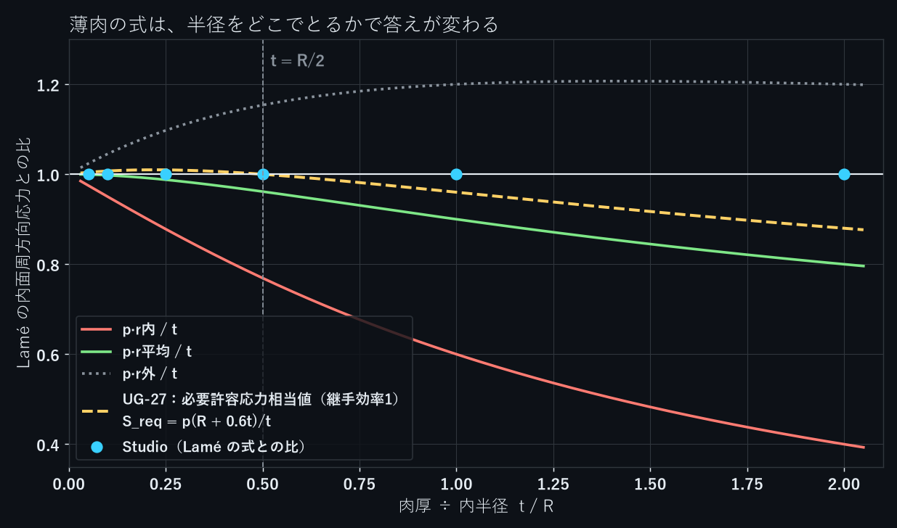

内圧を受ける円筒の周方向応力は、薄肉の式 $\sigma = pr/t$ で見積もるのが普通です。肉厚が厚くなると式は合わなくなりますが、どこまで使えるかは、式の $r$ に内半径・平均半径・外半径のどれを入れるかで大きく変わります。

内半径 10 mm の鋼の円筒に内圧 10 MPa をかけ、肉厚を 0.5〜20 mm（$t/R$ = 0.05〜2）に変えた6ケースを NovaSolver Studio で解きました。厚肉円筒の厳密解（Lamé の式）と比べ、そのうえで薄肉の式の3通りの $r$ と、圧力容器の規格の式を比べています。

## 結果

Studio と Lamé は内面の周方向応力、他の列は Studio に対する差です。UG-27 は継手効率1として必要許容応力の形に整理した比較値です。

| $t/R$ | 外半径 | Studio | Lamé | $pR/t$ | $pr_m/t$ | $pr_o/t$ | UG-27 $S_{\rm req}$（継手効率1） |
|---|---|---|---|---|---|---|---|
| 0.05 | 10.5 mm | 205.11 MPa | 205.12 | −2.5% | −0.1% | +2.4% | +0.4% |
| 0.1 | 11 mm | 105.23 MPa | 105.24 | −5.0% | −0.2% | +4.5% | +0.7% |
| 0.25 | 12.5 mm | 45.55 MPa | 45.56 | −12.2% | −1.2% | +9.8% | +1.0% |
| 0.5 | 15 mm | 26.00 MPa | 26.00 | −23.1% | −3.8% | +15.4% | 0.0% |
| 1 | 20 mm | 16.67 MPa | 16.67 | −40.0% | −10.0% | +20.0% | −4.0% |
| 2 | 30 mm | 12.50 MPa | 12.50 | −60.0% | −20.0% | +20.0% | −12.0% |

内面の周方向応力は、6ケースとも Studio と Lamé の式が 0.01% 以内で合いました。外面の周方向応力も Lamé の式と合い、内面近傍の半径方向応力は表面理論値 $-p$（−10 MPa）から最大約0.12%の差でした（測定半径10.0005 mm）。

$R$ は内半径、$r_m$ は平均半径、$r_o$ は外半径です。

- 内半径の $pR/t$ は、いつも低く見積もります（危険側）。$t/R$ = 0.1 で 5%、0.5 で 23% 低い
- 平均半径の $pr_m/t$ は、$t/R$ = 0.25 までなら差は最大約1.2%。ただし、これもいつも低い
- 外半径の $pr_o/t$ は、いつも高く見積もります（安全側）

## 式

Lamé の式で、内面の周方向応力は次のとおりです。

$$
\sigma_\theta(R) = p\,\frac{r_o^2 + R^2}{r_o^2 - R^2}
$$

これを $pr/t$ と比べると、$r_o > R$ なので $pr_o/t$ はどの肉厚でもこれより大きく、$pR/t$ と $pr_m/t$ はどの肉厚でも小さくなります（$t = r_o - R$ とおいて分母をそろえると分かります）。

ASME の圧力容器規格（Section VIII Division 1 の UG-27）の周方向の式を、継手効率1として必要許容応力の形に整理した比較値は次のとおりです。

$$
S_{\rm req} = \frac{p\,(R + 0.6\,t)}{t}
$$

この比較値は $t/R \le 0.5$ の範囲で Lamé の内面周方向応力との差が 1% 以内で、それを少し上回ります。$t/R = 0.5$ でちょうど一致し、それより厚いと下回ります。規格がこの式の適用範囲を $t \le R/2$ に限っているのと合っています。

## Studio での計算

円筒の 1/4 を、長さ 5 mm 分だけ読み込みました。切断面の2つと両端の面を対称面にしているので、長さ方向に伸び縮みしない状態（平面ひずみ）です。周方向応力と半径方向応力は、両端を自由にしても変わりません。

```python
t = import_geometry(path="lame_ro15.step", physics="structural", units="mm")
changes = {f"boundaries.{inner}.role": "pressure", f"boundaries.{inner}.pressure": "10 MPa",
           f"mesh.refine.{inner}": "0.5 mm"}
changes.update({f"boundaries.{f}.role": "symmetry" for f in (x0, y0, z0, z1)})
update_case(case_id=cid, expected_revision=1, changes=changes)
check_convergence(case_id=cid)    # 3段階のメッシュで解く
probe_results(case_id=cid, points=[[10.0005, 0, 2.5], [ro - 0.0005, 0, 2.5]])
```

$y = 0$ の面の上では、$\sigma_{yy}$ がそのまま周方向応力です。6ケースとも、3段階のメッシュで最大変位がほとんど変わらないこと（GCI 0.001% 以下）を確かめています。

## まとめ

- 厚肉円筒の内面の周方向応力は、6ケースとも Studio と Lamé の式が 0.01% 以内で合った
- 薄肉の式は、内半径を使うと危険側に、外半径を使うと安全側に外れる。$t/R = 0.1$ でも差は −5%（内半径）と +4.5%（外半径）ある
- $t/R \le 0.5$ なら、UG-27 の必要許容応力相当値 $S_{\rm req}=p(R + 0.6t)/t$（継手効率1）は Lamé の内面周方向応力との差が 1% 以内で、それを少し上回る。それより厚い円筒は Lamé の式で計算する

今回の計算は、v0.7.6 の後のローカル開発版（2026-11-11）で行いました。

NovaSolver Studio は無料のオープンソース（GPL-3.0）です。構造・熱・流れ・電場を1つのアプリで解け、Claude Desktop などの MCP クライアントから操作できます。

- 紹介・ダウンロード：https://novasolver.jp/studio/
- ソースコード（GitHub）：https://github.com/novasolver/novasolver-studio
