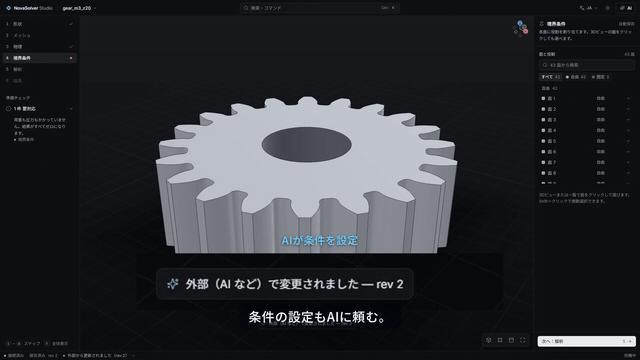
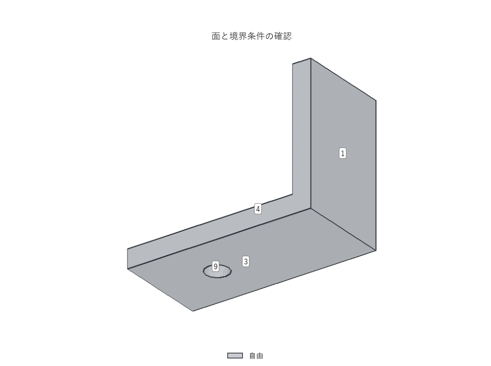
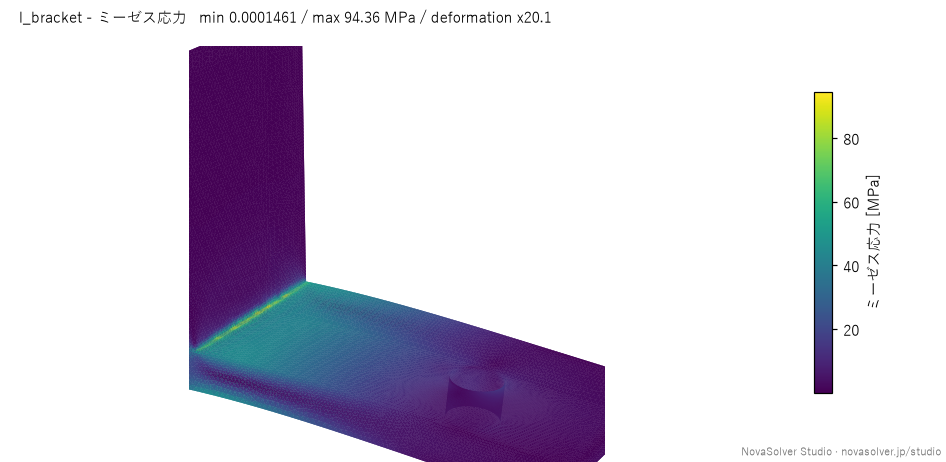
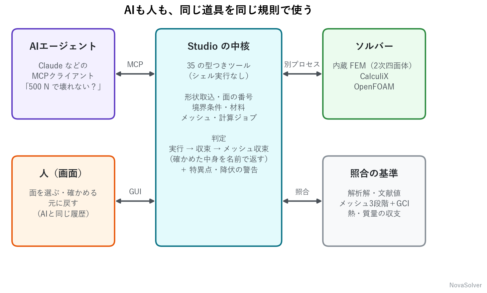
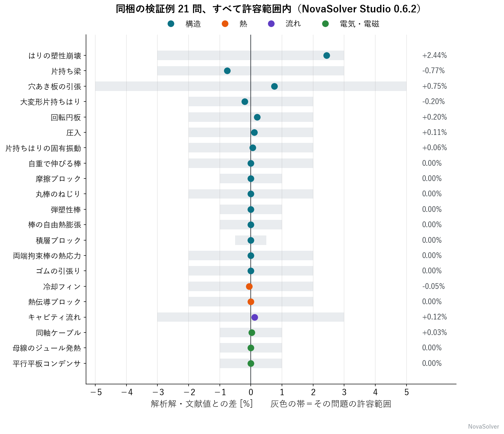

AIエージェントに流体解析や構造解析を回させること自体は、もう珍しくありません。MCPで解析ソフトを操作する例も増えました。

ただ、エージェントに解析を任せて本当に困るのは「計算が回るか」ではありません。**出てきた数字を信じていいのか**です。人間の解析者なら、メッシュを細かくして答えが動かないかを確かめ、角の応力が発散していないかを疑います。エージェントにもそれをやらせたい。

NovaSolverでは、オープンソースの解析ソフト **NovaSolver Studio** を作っています。構造・熱・流れ・電気を解けて、35個のMCPツールを持っています。この記事では、エージェントが自分の答えを疑えるようにするために、ツール側でどんな設計をしたかを書きます。

## まず、実際のやりとり

角を丸めていないL字の金具（同梱のサンプル `l_bracket.step`）を読み込み、壁側の面を固定して、穴に下向き500 Nをかけました。以下は MCP クライアントから Studio 0.7.5 を呼んだ実際の記録です（返答は原文から抜粋。ID や長い部分は「...」で省略し、ジョブの待ち合わせは1行にまとめています）。

```text
>>> import_geometry(path="l_bracket.step", physics="structural", units="mm")
Imported l_bracket.step as c_20261106_040111_596a (rev 1): 9 faces,
bounding box [0.0, 0.0, 0.0] - [80.0, 40.0, 60.0] mm. All faces start as 'free'.
f1 [free] Plane normal [-1.0, 0.0, 0.0], area 2400 mm2, centroid [0.0, 20.0, 30.0] mm
...
f9 [free] Cylinder, area 251.33 mm2, centroid [55.0, 20.0, 4.0] mm

>>> describe_case(case_id=..., detail="full")
l_bracket c_20261106_040111_596a rev 1 | mode preview -> builtin-fem | ready=False
[error] 固定された面がありません。物体が浮いたままなので解けません。
[error] 荷重も圧力もかかっていません。結果がすべてゼロになります。
```

面は番号と法線・重心で返ってきます。`render_view` を使えば、番号つきの画像でも確かめられます。



壁に当たる裏面が `f1`、穴が `f9` です。条件を入れます。画面を開いていれば、AIの操作はその場で画面にも反映されます。

```text
>>> update_case(case_id=..., expected_revision=1, changes={
      "boundaries.f1.role": "fixed",
      "boundaries.f9.role": "load", "boundaries.f9.force": "500 N", "boundaries.f9.direction": "-z",
      "materials.solid.preset": "aluminium"})
rev 2. boundaries.f1.role: free -> fixed; boundaries.f9.role: free -> load; ...

>>> validate_case(case_id=...)
GREEN

>>> run_simulation(case_id=..., mode="final")      # CalculiX
Running as r_20261106_040112_7b0d. Call job_status (it waits up to 20 s for the job).

>>> job_status(job_id=...)
done 100% - 完了 | ran=yes / converged=yes / mesh convergence not checked

>>> get_results(case_id=...)
ran=yes / converged=yes / mesh convergence not checked
最大ミーゼス応力: 49.71 MPa
最大変位: 0.3099 mm
```

ここで止めると「最大49.7 MPa、アルミなら余裕」と報告してしまいます。しかし返答の3つ目は `mesh convergence not checked` です。エージェントはメッシュ収束を確かめにいきます。

```text
>>> check_convergence(case_id=...)      # 粗い・標準・細かいの3段で解き直す
>>> job_status(job_id=...)
done 100% - 完了 | ran=yes / converged=yes / mesh convergence not reached

>>> get_results(case_id=...)
最大ミーゼス応力: 61.77 MPa
最大変位: 0.3145 mm
WARNING: 最大応力はメッシュを細かくするほど上がり続けています（49 → 50 → 62 MPa）。
鋭い角や完全固定した面の縁など、理想化した形・拘束による応力特異性の可能性があり、
この最大値そのものは強度の判断に使えません。実物どおりの丸みや支え方をモデル化するか、
評価する場所を決めて、そこでの応力が収束するかを確かめてください。

>>> verify_case(case_id=...)
メッシュ収束（最大変位、GCI）: finest mesh 0.31447 mm, no extrapolation
(the three meshes do not converge monotonically), GCI 7.8% (tolerance 5.0%) -> FAIL
```



応力が高いのは、丸みのない内側の角と、完全固定した面の縁でした。どちらも、メッシュを細かくするほど値が大きくなりやすい場所です。

この警告は、3段のメッシュでピーク応力が増え続け、最後の増分が3%を超えたときに出る検出則です。特異性を証明するものではなく「疑わしい」という合図ですが、エージェントにとっては「この最大値をそのまま報告するな」という十分な手がかりになります。最大変位のほうも、3段の値がそろわず基準に届いていません。

エージェントの次の手は、角と穴のまわりだけメッシュを細かくすることです。最初は細かくしすぎて、メモリが足りませんでした。

```text
>>> update_case(case_id=..., expected_revision=3, changes={
      "mesh.refine.f6": "1.5 mm", "mesh.refine.f7": "1.5 mm", "mesh.refine.f9": "1 mm"})
rev 4. ... [warn] 形状か粗さが変わったので、メッシュを作り直す必要があります。

>>> check_convergence(case_id=...)
>>> job_status(job_id=...)
failed 77% - CalculiX が節点数 234220 のモデルの計算中に停止しました（終了コード 3221225477）。
このサイズでは多くの場合メモリ不足が原因です。メッシュを粗くするか、
必要なメモリが少ない内蔵ソルバー（プレビューモード）で解いてください。
```

返答どおり少し粗くして、やり直します。

```text
>>> update_case(case_id=..., expected_revision=4, changes={
      "mesh.refine.f6": "2 mm", "mesh.refine.f7": "2 mm", "mesh.refine.f9": "1.5 mm"})
rev 5. ...

>>> check_convergence(case_id=...)
>>> job_status(job_id=...)
done 100% - 完了 | ran=yes / converged=yes / mesh convergence (GCI) passed

>>> get_results(case_id=...)
最大ミーゼス応力: 94.36 MPa
最大変位: 0.3183 mm
WARNING: 最大応力はメッシュを細かくするほど上がり続けています（63 → 77 → 94 MPa）。...

>>> verify_case(case_id=...)
メッシュ収束（最大変位、GCI）: finest mesh 0.31834 mm, Richardson extrapolation 0.31919 mm,
GCI 0.33% (tolerance 5.0%) -> PASS

>>> probe_results(case_id=..., faces=["f9"])
f9 (251.3 mm2) mean: ... vm 7.2042 MPa ...; max: ... vm 16.653 MPa ...
```

結果は次のようにまとまりました。

| 量 | 値 | 判断 |
|---|---|---|
| 最大変位 | 0.318 mm | GCI 0.33%。この量のメッシュ収束は基準を満たした |
| 角の最大応力 | 63 → 77 → 94 MPa と増え続ける | 特異性が疑われる。この値では判断しない |
| 穴の面の最大応力 | 16.645 → 16.653 MPa（局所細分化の前後） | 変化は0.05%。ただし3段の収束評価はしていない |

エージェントがユーザーに返すべき答えは「最大94 MPa」ではありません。たとえば次のような答えです。

> このモデルの最大変位は 0.32 mm で、メッシュによる誤差の見積もり（GCI）は 0.33% です。荷重のかかる穴の面の応力は約17 MPa で、局所的にメッシュを細かくしてもほとんど変わりませんでした。内側の角は特異性が疑われ、このピーク値は収束していません。実物の丸み（R）を入れて評価し直す必要があります。

そう言えるだけの材料が、ツールの返答の中にそろっています。なお、メッシュ収束の基準を満たしても、分かるのは対象量のメッシュによる誤差の見積もりだけです。材料・拘束のモデル化が実物と合っていることや、安全性までは保証しません。

## 設計1：何を確かめたかを、毎回その名前で返す



計算系のツールは、毎回この形の1行を返します。

```text
ran=yes / converged=yes / mesh convergence not checked
```

| 項目 | 意味 |
|---|---|
| ran | ソルバが最後まで走った |
| converged | 解析の種類ごとの収束基準を満たした（非線形は反復の収束、外部流れは抗力係数の安定など） |
| 3つ目 | 何を確かめたかを、その名前で書く。メッシュを3段で解いていなければ `mesh convergence not checked`、解いて基準（GCI ≤ 5% など）を満たせば `mesh convergence (GCI) passed`、満たさなければ `mesh convergence not reached`。理論解のある例題では `matches reference` |

以前は3つ目を `verified` と1語で返していました。しかし、メッシュ収束を確かめても、境界条件や材料が実物と合っているかは分かりません。1語にまとめると、エージェントがそれを「検証済み」と言い換えてしまいます。

そこで、確かめた中身をそのまま書くようにしました。MCPサーバの説明文でも、エージェントに次のように指示しています。

```text
Do not call a result "verified" or "validated": neither check covers the
boundary conditions, the material or the real part.
```

理論解のない形で `verify_case` を呼ぶと、「この形状には理論解がありません」と返します。降伏応力を設定した線形の構造解析では、降伏応力を超えた結果に「線形解析の前提が崩れている」と警告します（弾塑性モデルや複数材料のケースなど、出ない条件もあります）。どの判定も「安全」という意味ではないことを、ツール側から伝える仕組みです。

## 設計2：型つきツールだけ。シェルもソルバの辞書も渡さない

35個のツールは、すべて引数の型が決まっています。シェル実行やコード実行のツールはありません。

OpenFOAM の辞書や CalculiX の入力ファイルを、エージェントに直接書かせることもしません。エージェントが埋めるのは、`boundaries.f9.force = "500 N"` のような、**ドット区切りのパスと単位つきの値**だけです。ソルバの入力は Studio が生成します。

こうしておくと、間違いが「エラーメッセージ付きで弾かれる」形で表に出ます。

```text
>>> describe_case(case_id=..., detail="faces")
Error executing tool describe_case: 1 validation error
detail  Input should be 'concise' or 'full'
```

## 設計3：数字は文字で返し、画像は確認用にする

`render_view` のツール説明には、**"Read numbers from get_results, not pictures."** と書いています。

画像は「どの面を固定したか」を人と確かめるためのもの、数値は `get_results` や `probe_results` の文字で読むもの、と役割を分けています。マルチモーダルなモデルでも、カラーバーの色から値を読ませると読み違えるおそれがあるためです。

## 設計4：人とAIが同じケースを触っても壊れない

Studio の画面とエージェントは、同じケースを同時に開けます。変更には `expected_revision` を付けさせ、ずれていれば書き換えを拒否します。この記事のために最初に試したときも、実際に一度弾かれました。直前の `run_simulation(mode="final")` で実行モードが書き換わり、版が上がっていたのを見落としていたためです。

```text
>>> update_case(case_id=..., expected_revision=2, changes={"mesh.refine.f6": "1.5 mm", ...})
ケースは別の操作で更新されています（現在の revision は 3）。
describe_case で最新を読み、expected_revision=3 で再度呼んでください。
```

エラー文に「次に何をすればよいか」まで書いておくと、エージェントは自分で読み直して再試行します。

ほかにも、人とAIの協調のために次の仕組みがあります。

- **共通の Undo/Redo**：画面と AI の変更が同じ履歴に入る。Ctrl+Z で AI の変更も戻せる。
- **`get_gui_selection`**：人が画面で選んだ面を AI が読める。「選んだ面を固定して」が通じる。

## 設計5：重い計算はジョブにする

`run_simulation` は約20秒だけ待ち、終わらなければ `job_id` を返します。エージェントは `job_status` を呼んで進み具合と残り時間を見ます。MCP の1回の呼び出しで数分ブロックすると、クライアントによってはタイムアウトするためです。

## 理論解と比べた例題

`matches reference` の基準として、配布物には、解析解・文献値・近似式と比べた21の例題を同梱しています。



全問が許容範囲内で、最大は塑性崩壊荷重の +2.44% です。`list_examples` と `open_example` で、エージェントからも開けます。

## 使ってみる

Claude Desktop なら、Releases の `.mcpb` を開くだけで入ります。Python があれば、次の設定でも動きます。

```json
{
  "mcpServers": {
    "novasolver-studio": { "command": "uvx", "args": ["novasolver-studio", "mcp"] }
  }
}
```

あとは、たとえばこう頼みます。

> bracket.step を読み込んで、底の面を固定、上の面に 500 N。計算して、メッシュ収束まで確かめて

## おわりに

エージェントに解析を任せるとき、ツールに求めるべきは「速く解ける」ことより「間違いを言ってくれる」ことだと思っています。

- GitHub：https://github.com/novasolver/novasolver-studio
- 紹介ページ：https://novasolver.jp/studio/

GPL-3.0 です。MCPまわりの設計に意見があれば、Issue や Discord（https://novasolver.jp/community/ ）でぜひ。
