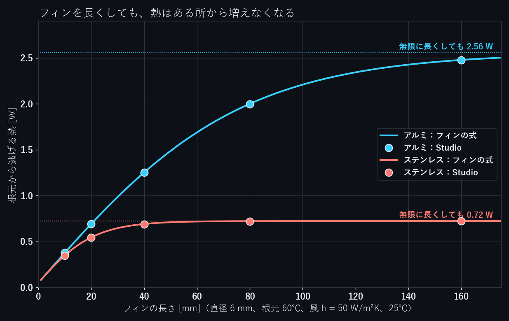
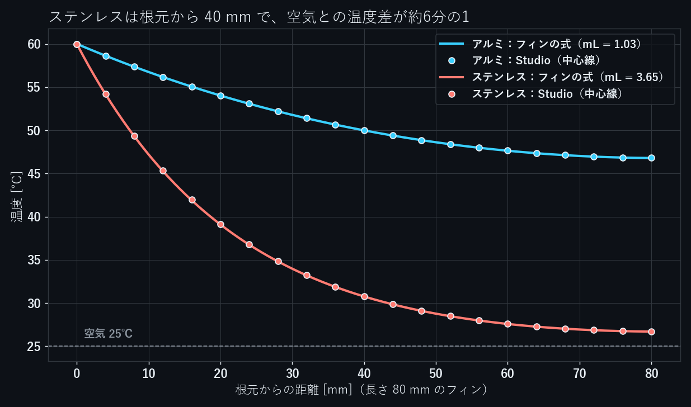

ヒートシンクのフィンを長くすれば、表面積が増えて熱がよく逃げる。これは途中までしか成り立ちません。先へ行くほどフィンの温度が空気に近づき、伸ばした部分がほとんど働かなくなるからです。

直径 6 mm のピンフィンを、アルミとステンレスで長さ 10〜160 mm の10ケース、NovaSolver Studio の熱伝導解析で解き、フィンの式と比べました。

## 式

細い棒の根元を温度 $T_b$ に保ち、まわりの空気（温度 $T_\infty$、熱伝達率 $h$）へ熱を逃がすと、棒に沿った温度は指数関数的に空気の温度へ近づきます。その速さを決めるのが

$$
m = \sqrt{\frac{hP}{kA}} = \sqrt{\frac{4h}{kD}}
$$

です（$P$ は周長、$A$ は断面積、$k$ は熱伝導率）。先端からも熱が逃げるとして、根元から入る熱は

$$
Q = \sqrt{hPkA}\,\theta_b\,\frac{\sinh mL + (h/mk)\cosh mL}{\cosh mL + (h/mk)\sinh mL}, \qquad \theta_b = T_b - T_\infty
$$

$L$ を大きくすると分数は 1 に近づき、$Q$ は $\sqrt{hPkA}\,\theta_b$ で頭打ちになります。先端の熱を無視すれば分数は $\tanh mL$ で、$mL = 2$ で上限の 96% です。

```python
import math

h, D, Tb, Tinf = 50.0, 0.006, 60.0, 25.0     # W/m2K, m, ℃, ℃
P, A, th = math.pi * D, math.pi * D**2 / 4, Tb - Tinf

for name, k in (("アルミ", 200.0), ("ステンレス", 16.0)):
    m = math.sqrt(h * P / (k * A))
    M = math.sqrt(h * P * k * A) * th            # 無限に長いフィンの熱
    g = h / (m * k)
    print(f"{name}: m = {m:.1f} 1/m, 上限 {M:.3f} W")
    for L in (0.01, 0.02, 0.04, 0.08, 0.16):
        q = M * (math.sinh(m*L) + g*math.cosh(m*L)) / (math.cosh(m*L) + g*math.sinh(m*L))
        print(f"  L = {L*1000:3.0f} mm  mL = {m*L:4.2f}  Q = {q:.4f} W ({q/M:4.0%})")
# アルミ: m = 12.9 1/m, 上限 2.555 W
#   L =  10 mm  mL = 0.13  Q = 0.3766 W ( 15%)
#   L =  20 mm  mL = 0.26  Q = 0.6916 W ( 27%)
#   L =  40 mm  mL = 0.52  Q = 1.2514 W ( 49%)
#   L =  80 mm  mL = 1.03  Q = 1.9998 W ( 78%)
#   L = 160 mm  mL = 2.07  Q = 2.4774 W ( 97%)
# ステンレス: m = 45.6 1/m, 上限 0.723 W
#   L =  10 mm  mL = 0.46  Q = 0.3480 W ( 48%)
#   L =  20 mm  mL = 0.91  Q = 0.5447 W ( 75%)
#   L =  40 mm  mL = 1.83  Q = 0.6907 W ( 96%)
#   L =  80 mm  mL = 3.65  Q = 0.7219 W (100%)
#   L = 160 mm  mL = 7.30  Q = 0.7227 W (100%)
```

この式は、断面の中の温度差を無視した1次元のモデルです。半径方向のビオ数 $hr/k$ はアルミで 0.00075、ステンレスで 0.0094 と十分小さいので、前提は成り立っています。

## 条件

| 項目 | 値 |
|---|---|
| 形 | 直径 6 mm の円柱、長さ 10 / 20 / 40 / 80 / 160 mm |
| 材料 | アルミ（$k$ = 200 W/mK）、ステンレス（$k$ = 16 W/mK） |
| 根元の面 | 60℃ に固定 |
| 側面と先端 | 空気 25℃、$h$ = 50 W/m²K（ファンで風を当てた程度） |

## MCP で解く

解析条件の設定と計算は、AI から呼び出せる MCP のツールで行いました。アルミ 80 mm のやりとりの抜粋です（→ の後ろが Studio の返答）。

```text
import_geometry  fin80.step（熱）
→ Imported fin80.step as c_20261108_194155_bdcb (rev 1): 3 faces, ...
  f1 [insulated] Cylinder, area 1507.96 mm2, centroid [0.0, 0.0, 40.0] mm
  f2 [insulated] Plane normal [0.0, 0.0, 1.0], area 28.27 mm2, centroid [-0.0, -0.0, 80.0] mm
  f3 [insulated] Plane normal [0.0, 0.0, -1.0], area 28.27 mm2, centroid [-0.0, -0.0, 0.0] mm

update_case  f3 = 60 degC / f1, f2 = 対流 50 W/m2K, 25 degC / k = 200 W/mK / mesh.refine.f1 = 0.75 mm
validate_case
→ GREEN
  f1 (面 1): 対流 h 50 W/m²K、外気 25 °C。
  f2 (面 2): 対流 h 50 W/m²K、外気 25 °C。
  f3 (面 3): 60 °C。
  材料: 任意、熱伝導率 200 W/mK。

check_convergence  （粗い・標準・細かいの3つのメッシュで解き直す）
→ Running as r_20261108_194156_9e6c.
job_status
→ done 100% - 完了 | ran=yes / converged=yes / mesh convergence (GCI) passed

get_results
→ 最高温度: 60.0 °C
  最低温度: 46.8 °C
  流入する熱量: 1.998 W

verify_case
→ メッシュ収束（温度差、GCI）: finest mesh 13.204 K, Richardson extrapolation 13.213 K, GCI 0.08% (tolerance 5.0%) -> PASS
```

面の向きと位置から、根元（z = 0 の面）と先端・側面を選んでいます。

`mesh.refine.f1` は、側面のメッシュの寸法を指定する設定です。最初に指定せずに解いたところ、40 mm 以上のフィンでは3段階のメッシュがほとんど同じになり、Studio は「答えの確かさは判定できません」と警告しました。そこで10ケースとも側面を 0.75 mm に指定して解き直し、全ケースでメッシュ収束の確認（対象はフィン内の温度差）を通しています。

## 結果

| 材料 | 長さ | mL | Studio | フィンの式 | 差 |
|---|---|---|---|---|---|
| アルミ | 10 mm | 0.13 | 0.3762 W | 0.3766 W | −0.12% |
| アルミ | 20 mm | 0.26 | 0.6908 W | 0.6916 W | −0.11% |
| アルミ | 40 mm | 0.52 | 1.250 W | 1.251 W | −0.09% |
| アルミ | 80 mm | 1.03 | 1.998 W | 2.000 W | −0.07% |
| アルミ | 160 mm | 2.07 | 2.476 W | 2.477 W | −0.05% |
| ステンレス | 10 mm | 0.46 | 0.3471 W | 0.3480 W | −0.27% |
| ステンレス | 20 mm | 0.91 | 0.5434 W | 0.5447 W | −0.24% |
| ステンレス | 40 mm | 1.83 | 0.6895 W | 0.6907 W | −0.18% |
| ステンレス | 80 mm | 3.65 | 0.7208 W | 0.7219 W | −0.15% |
| ステンレス | 160 mm | 7.30 | 0.7216 W | 0.7227 W | −0.15% |

10ケースとも、根元から入る熱は式と 0.3% 以内で一致しました。

ステンレスは 40 mm で上限の 95% に達し、そこから 160 mm まで4倍に伸ばしても、熱は 0.6895 W から 0.7216 W へ 5% しか増えません。アルミは 160 mm でも上限の 97% で、80 mm から 160 mm に伸ばすと熱は 24% 増えます。

## 中を見る



長さ 80 mm のフィンの中心線の温度です。ステンレスは根元から 40 mm で 30.8℃ になり、空気との温度差が根元の約6分の1まで縮みます。先へ行くほど空気との温度差が小さくなり、単位長さあたりの放熱も小さくなります。アルミは先端でも 46.8℃ で、全体が働いています。

フィンをどこまで長くする意味があるかは、$mL$ でおおよそ決まります。$mL$ が 2 を超えて伸ばしても、材料と重さが増えるわりに熱の増え方は小さくなります。この条件では、アルミで約 155 mm、ステンレスで約 44 mm です。

## まとめ

- 直径 6 mm のピンフィン10ケースで、Studio の熱量はフィンの式と 0.3% 以内で一致した
- ステンレスは 40 mm で上限の 95%、アルミは 160 mm で 97% に達し、それより長くしても熱はほとんど増えない
- フィンの長さは $mL \approx 2$ が目安。熱伝導率が低い材料ほど短い長さで頭打ちになる

NovaSolver Studio は無料のオープンソース（GPL-3.0）です。構造・熱・流れを1つのアプリで解け、Claude Desktop などの MCP クライアントから操作できます。

- 紹介・ダウンロード：https://novasolver.jp/studio/
- ソースコード（GitHub）：https://github.com/novasolver/novasolver-studio
