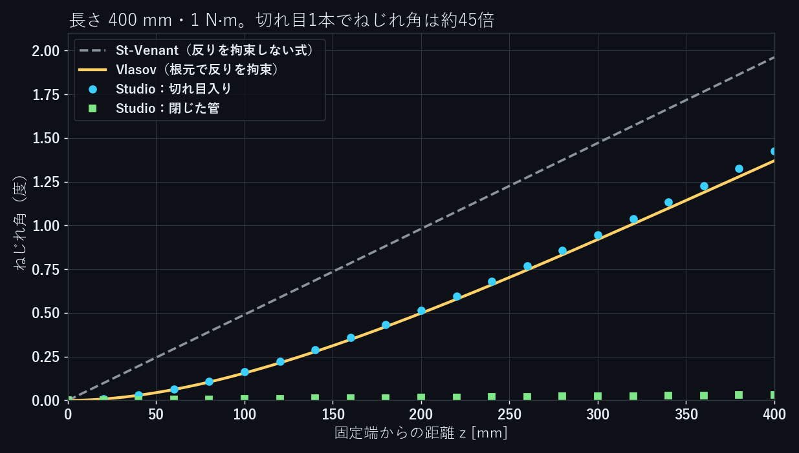
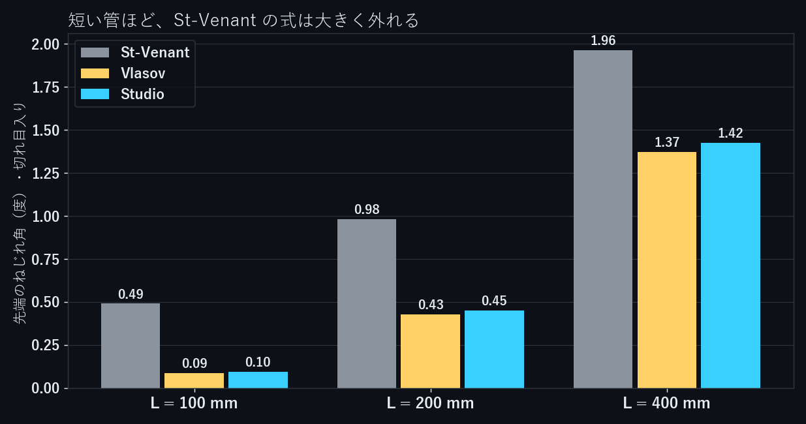
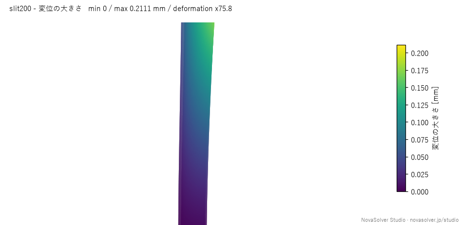

同じパイプでも、長さ方向に幅 1 mm の切れ目を1本入れるだけで、同じトルクでのねじれ角がずっと大きくなります。何倍になるかは、式の選び方で大きく変わります。

外径 20 mm・肉厚 2 mm の鋼管を、閉じたものと切れ目入りのもので長さ 100 / 200 / 400 mm の6ケース、NovaSolver Studio の構造解析で解きました。根元を固定し、先端に 1 N·m のねじりモーメントをかけて、ねじれ角を式と比べています。

## 式

閉じた円管のねじれ角は、断面の極断面二次モーメント $J$ で決まります。

$$
\theta = \frac{TL}{GJ}, \qquad J_\text{closed} = \frac{\pi}{2}\left(r_o^4 - r_i^4\right)
$$

切れ目を入れると、断面は1枚の細長い板を丸めた形（開いた断面）になります。薄い板のねじり定数は、中心線の長さ $s$ と厚さ $t$ から

$$
J_\text{open} = \frac{s\,t^3}{3}
$$

です。この寸法では $J_\text{closed} = 9274\ \text{mm}^4$、$J_\text{open} = 148\ \text{mm}^4$ で、約63分の1になります。これを閉じた管と同じ式 $\theta = TL/(GJ)$ に入れたものが St-Venant のねじりです。

ただし開いた断面は、ねじると切れ目の両側が長さ方向に食い違います（反り）。根元を固定すると、この反りが止められ、そのぶんねじれにくくなります。これを入れたのが Vlasov の式で、根元で反りを拘束し、先端では自由とすると

$$
\theta(L) = \frac{T}{GJ}\left(L - \frac{\tanh kL}{k}\right), \qquad k = \sqrt{\frac{GJ}{E\Gamma}}
$$

となります。$\Gamma$ はそり定数で、断面の中心線に沿った扇形面積から求めます。

```python
import math
import numpy as np

E, nu = 205e9, 0.30
G = E / (2 * (1 + nu))
ro, ri, gap, T = 0.010, 0.008, 0.001, 1.0
t, rm = ro - ri, (ro + ri) / 2

# 中心線（切れ目は +x 側）。扇形面積を最小二乗で正規化して Γ を求める
phi0 = gap / rm / 2
s = np.linspace(phi0, 2 * math.pi - phi0, 200001)
x, y = rm * np.cos(s), rm * np.sin(s)
ds = rm * (s[1] - s[0])
w0 = rm**2 * (s - s[0])
A = np.column_stack([np.ones_like(s), x, y])
c, *_ = np.linalg.lstsq(A * math.sqrt(t * ds), w0 * math.sqrt(t * ds), rcond=None)
Gamma = float(np.sum((w0 - A @ c) ** 2) * t * ds)

J_closed = math.pi / 2 * (ro**4 - ri**4)
J_open = rm * (s[-1] - s[0]) * t**3 / 3
k = math.sqrt(G * J_open / (E * Gamma))
print(f"J_closed {J_closed*1e12:.0f} mm4, J_open {J_open*1e12:.1f} mm4, "
      f"Gamma {Gamma*1e18:.4g} mm6, 1/k {1/k*1e3:.0f} mm")
for L in (0.1, 0.2, 0.4):
    c_ = T * L / (G * J_closed)
    sv = T * L / (G * J_open)
    vl = T / (G * J_open) * (L - math.tanh(k * L) / k)
    print(f"L = {L*1000:3.0f} mm  閉 {math.degrees(c_):.4f}°  "
          f"St-Venant {math.degrees(sv):.3f}°  Vlasov {math.degrees(vl):.3f}°")
# J_closed 9274 mm4, J_open 148.1 mm4, Gamma 8.344e+05 mm6, 1/k 121 mm
# L = 100 mm  閉 0.0078°  St-Venant 0.491°  Vlasov 0.088°
# L = 200 mm  閉 0.0157°  St-Venant 0.981°  Vlasov 0.429°
# L = 400 mm  閉 0.0313°  St-Venant 1.962°  Vlasov 1.370°
```

$1/k$ = 121 mm は、根元の反りの拘束が効く長さの目安です。管がこれより短いと、St-Venant の式はねじれ角を何倍も大きく見積もります。

幅ゼロの切れ目を入れた開いた円管の $\Gamma$ には $\frac{2\pi^3 r^5 t}{3}\left(1 - \frac{6}{\pi^2}\right)$ という式があり、上のコードで `gap = 0` とするとこの値（$9.571\times10^5\ \text{mm}^6$）と一致します（`gap = 0` でも両端はつながず、開いた断面のまま計算しています）。閉じた円管は、ねじっても反りが生じません。切れ目の幅 1 mm を入れると $8.344\times10^5\ \text{mm}^6$ です。

## 条件

| 項目 | 値 |
|---|---|
| 形 | 外径 20 mm・内径 16 mm の円管。切れ目入りは +x 側に幅 1 mm のすき間を全長に入れたもの |
| 長さ | 100 / 200 / 400 mm |
| 材料 | 鋼（$E$ = 205 GPa、$\nu$ = 0.3） |
| 根元（z = 0 の面） | 固定 |
| 先端（z = L の面） | z 軸まわりに 1 N·m のねじりモーメント |

ねじれ角は、軸をはさんで向かい合う2点 (0, ±9, z) の x 方向の変位の差を 18 mm で割って求めました。管全体の平行移動は差をとると消えます。

## MCP で解く

解析条件の設定と計算は、AI から呼び出せる MCP のツールで行いました。切れ目入り 200 mm のやりとりの抜粋です（→ の後ろが Studio の返答）。

```text
import_geometry  slit200.step（構造）
→ Imported slit200.step as c_20261110_091202_3838 (rev 1): 6 faces, ...
  f1 [free] Cylinder, area 12366.3 mm2, centroid [-0.16, 0.0, 100.0] mm
  f2 [free] Plane normal [0.0, 0.0, 1.0], area 111.1 mm2, centroid [-0.16, 0.0, 200.0] mm
  f3 [free] Plane normal [0.0, 1.0, 0.0], area 400.63 mm2, centroid [8.99, -0.5, 100.0] mm
  f4 [free] Plane normal [0.0, 0.0, -1.0], area 111.1 mm2, centroid [-0.16, 0.0, 0.0] mm
  f5 [free] Plane normal [0.0, -1.0, 0.0], area 400.63 mm2, centroid [8.99, 0.5, 100.0] mm
  f6 [free] Cylinder, area 9852.97 mm2, centroid [-0.16, 0.0, 100.0] mm

update_case  f4 = 固定 / f2 = モーメント 1 N-m, +z / 鋼 / mesh.refine.f1, f6 = 1.5 mm
validate_case
→ GREEN
  f2 (面 2): モーメント、torque 1.0 N-m, direction +z, point [0, 0, 0] mm。
  支持: f4 (面 4) = 固定。
  材料: 鋼、E 205 GPa、降伏応力 235 MPa。

check_convergence  （粗い・標準・細かいの3つのメッシュで解き直す）
→ done 100% - 完了 | ran=yes / converged=yes / mesh convergence (GCI) passed

verify_case
→ メッシュ収束（最大変位、GCI）: finest mesh 0.21107 mm, ... GCI 0.58% (tolerance 5.0%) -> PASS

probe_results  points = (0, ±9, z) を z = 0〜200 mm の21か所
```

面の種類・向き・重心の位置から、根元（f4）と先端（f2）を選んでいます。f3 と f5 は切れ目の両側の面で、何も拘束しません。

切れ目入りの管では、Studio は「最大応力は固定した面の縁に出ていて、メッシュを細かくするほど上がり続けている」と警告しました。完全固定の縁で起きる応力特異性で、この最大応力は強度の判断に使えません。今回比べるのはねじれ角（変位）で、メッシュ収束の確認は6ケースとも通っています。

## 結果

| 長さ | 閉じた管 Studio | 閉じた管 式 | 切れ目入り Studio | Vlasov | St-Venant |
|---|---|---|---|---|---|
| 100 mm | 0.0078° | 0.0078° | 0.095° | 0.088° | 0.491° |
| 200 mm | 0.0157° | 0.0157° | 0.452° | 0.429° | 0.981° |
| 400 mm | 0.0313° | 0.0313° | 1.424° | 1.370° | 1.962° |

閉じた管は、3ケースとも式と 0.01% 以内で一致しました。

切れ目入りは、Vlasov の式より 4〜8% 大きく、St-Venant の式の 0.19〜0.73 倍でした。長さ 100 mm では、St-Venant の式はねじれ角を約5倍に見積もっています。



切れ目1本でねじれ角は、長さ 100 mm で12倍、200 mm で29倍、400 mm で45倍になりました。管が長いほど根元の拘束の効きが薄まり、比は $J_\text{closed}/J_\text{open}$ = 63 に近づいていきます。

Vlasov の式との 4〜8% の差は、短い管ほど大きくなっています。この管は肉厚が半径の約2割あり、薄肉を前提にした式からは少し外れます。

## 中を見る



切れ目入り 200 mm の変位の大きさです（変形は約76倍に拡大）。根元の近くではほとんど回らず、先へ行くほど回転が大きくなっています。最初の図の Vlasov の曲線のとおり、ねじれ角は根元付近で z に対して直線ではなく、ゆるやかに立ち上がります。

## まとめ

- 外径 20 mm・肉厚 2 mm の鋼管で、閉じた管のねじれ角は Studio と式が 0.01% 以内で一致した
- 幅 1 mm の切れ目でねじれ角は 12〜45 倍になる。倍率は長さで変わる
- 切れ目入りの管では、根元の反りの拘束を入れた Vlasov の式が Studio と 4〜8% で合い、St-Venant の式は短い管でねじれ角を大きく見積もる

今回の計算は、v0.7.6 の後のローカル開発版（2026-11-10）で行いました。

NovaSolver Studio は無料のオープンソース（GPL-3.0）です。構造・熱・流れを1つのアプリで解け、Claude Desktop などの MCP クライアントから操作できます。

- 紹介・ダウンロード：https://novasolver.jp/studio/
- ソースコード（GitHub）：https://github.com/novasolver/novasolver-studio
