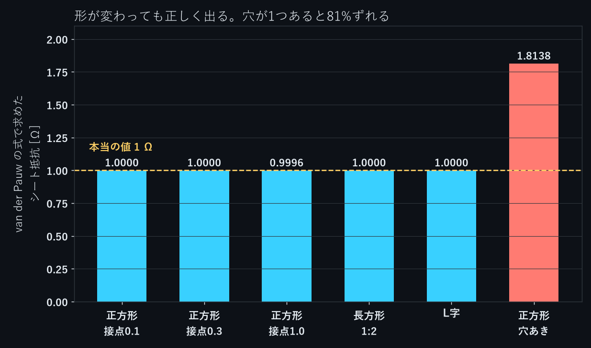

薄膜や半導体のシート抵抗は、van der Pauw 法で測るのが定番です。試料の縁に4つの接点 A、B、C、D を順に置き、2通りの4端子抵抗を測ります。

$$
R_1 = R_{AB,CD} = \frac{V_D - V_C}{I_{AB}}, \qquad R_2 = R_{BC,DA} = \frac{V_A - V_D}{I_{BC}}
$$

この2つから、次の式でシート抵抗 $R_s$ が決まります。

$$
e^{-\pi R_1 / R_s} + e^{-\pi R_2 / R_s} = 1
$$

この式は、試料が一様な材料・一様な厚さで、穴がなく、接点が縁の上の点であれば、**どんな形でも** 成り立ちます。これを NovaSolver Studio の電流解析で、形の違う6つの試料について確かめました。

## 試料

どれも厚さ 1 mm、導電率 1000 S/m で、本当のシート抵抗は $R_s = 1/(\sigma t)$ = 1 Ω です。接点は、角を 45° に切り落とした小さな面です（脚の長さ $c$）。

- 正方形 10×10 mm、$c$ = 0.1、0.3、1.0 mm（接点の大きさを変える）
- 長方形 10×20 mm、$c$ = 0.2 mm
- L字（20×20 mm から 10×10 mm を切り欠いた形）、$c$ = 0.2 mm
- 正方形 10×10 mm の中央に半径 2 mm の穴、$c$ = 0.2 mm

## 結果

$R_1$、$R_2$ を Studio で計算し、上の式で $R_s$ を求めました。「2次元の計算」は、同じ形と同じ境界条件を、自作の2次元有限要素法（三角形1次要素）で解いた値です。

| 試料 | $R_1$ Studio | $R_2$ Studio | 2次元の計算 | $R_s$ |
|---|---|---|---|---|
| 正方形 $c$ = 0.1 | 0.22063 Ω | （$R_1$ と同じ） | 0.22064 | 1.0000 Ω |
| 正方形 $c$ = 0.3 | 0.22063 Ω | （$R_1$ と同じ） | 0.22064 | 1.0000 Ω |
| 正方形 $c$ = 1.0 | 0.22055 Ω | （$R_1$ と同じ） | 0.22055 | 0.9996 Ω |
| 長方形 1:2 | 1.12220 Ω | 0.00951 Ω | 1.12220 / 0.00951 | 1.0000 Ω |
| L字 | 0.86013 Ω | 0.02210 Ω | 0.86021 / 0.02209 | 1.0000 Ω |
| 穴あき正方形 | 0.40020 Ω | （$R_1$ と同じ） | 0.40019 | **1.8138 Ω** |
 
正方形と穴あき正方形は、試料と接点の配置が90°回しても同じなので、$R_2 = R_1$ です。2通り目の計算は省きました。

正方形・長方形・L字では、$R_1$ と $R_2$ が大きく違っても（長方形で 118 倍、L字で 39 倍）、$R_s$ は本当の値 1 Ω と 0.04% 以内で一致しました。L字の $R_s$ は 1.00001 Ω です。点接点の正方形の理論値 $R = R_s \ln 2/\pi$ = 0.22064 Ω とも合っています。

穴が1つあると、$R_s$ は 1.81 Ω と出て、81% 大きくずれます。穴を避けて電流が回り込むので、$R_1$、$R_2$ が大きくなります。van der Pauw の式は「穴がない」ことを前提にしているので、穴があると使えません。

Studio と2次元の計算の差は、8回の計算すべてで 0.05% 以内でした（L字の2次元の計算は、角の近くの収束が遅く、それ自体に 0.1% 程度の幅があります）。

## 接点の大きさと、4端子で測る理由

今回のモデルでは、接点の脚の長さを辺の 10%（1 mm）まで大きくしても、$R_s$ の誤差は 0.04% でした。C・D は絶縁面の中点で電位を読み、有限な金属電極が面全体で等電位になる効果は含めていません。

一方、同じ計算で出る **2端子の抵抗**（電流を流す A と B の間の電圧 ÷ 電流）は、正方形で次のとおりです。

| 接点 $c$ | 2端子の抵抗 | 4端子の $R_1$ |
|---|---|---|
| 0.1 mm | 5.52 Ω | 0.2206 Ω |
| 0.3 mm | 4.13 Ω | 0.2206 Ω |
| 1.0 mm | 2.60 Ω | 0.2205 Ω |

2端子の抵抗は4端子の 12〜25 倍で、接点の大きさで大きく変わります。小さな接点に電流が集まる部分の抵抗（くびれ抵抗）が入るからです。電圧を電流が流れていない C、D で測る4端子なら、電流接点付近の局所的な電圧降下を直接測らずに済みます。

## Studio での計算

接点 A を 1 V、B を 0 V にして解き、C と D の電位を読みました。電流は 1 V ÷ 2端子の抵抗です。

```python
t = import_geometry(path="vdp_L_c0p2.step", physics="current", units="mm")
update_case(case_id=cid, expected_revision=1, changes={
    "materials.solid.sigma": "1000 S/m", "physics.joule_heating": False,
    f"boundaries.{A}.role": "voltage", f"boundaries.{A}.voltage": "1 V",
    f"boundaries.{B}.role": "voltage", f"boundaries.{B}.voltage": "0 V",
    f"mesh.refine.{A}": "0.02 mm", f"mesh.refine.{B}": "0.02 mm"})
check_convergence(case_id=cid)                  # 3段階のメッシュで解く
probe_results(case_id=cid, points=[C_mid, D_mid])  # C、D の電位
```

$R_s$ は、2つの抵抗から数値的に解きます。

```python
import math
from scipy.optimize import brentq

def sheet_resistance(R1, R2):
    f = lambda rs: math.exp(-math.pi * R1 / rs) + math.exp(-math.pi * R2 / rs) - 1
    return brentq(f, 1e-6, 1e6)

print(sheet_resistance(0.86013, 0.02210))   # L字 → 1.0001（丸める前の値では 1.00001）
```

Studio は、3段階のメッシュで2端子の抵抗が変わらないかを判定します。電圧駆動で、接点面を細かくしない設定では、8回のうち2回で判定が通りませんでした（GCI 6.9% と 10%、許容 5%）。脚 0.2 mm の小さな接点のまわりが、メッシュで十分に分けられていなかったためです。接点の面を $c$/10 の大きさで細かくすると、8回とも判定を通りました。

## まとめ

- 正方形・長方形・L字の試料で、van der Pauw の式から求めたシート抵抗は本当の値と 0.04% 以内で合った
- 穴が1つある試料では 81% 大きく出る。穴のない試料で測る
- 今回のモデルでは、角に置いた接点は辺の 10% の大きさでも誤差 0.04%。2端子の抵抗は接点の大きさで2倍以上変わり、4端子の値の変化は小さい

今回の計算は、v0.7.6 の後のローカル開発版（2026-11-12）で行いました。

NovaSolver Studio は無料のオープンソース（GPL-3.0）です。構造・熱・流れ・電場を1つのアプリで解け、Claude Desktop などの MCP クライアントから操作できます。

- 紹介・ダウンロード：https://novasolver.jp/studio/
- ソースコード（GitHub）：https://github.com/novasolver/novasolver-studio
